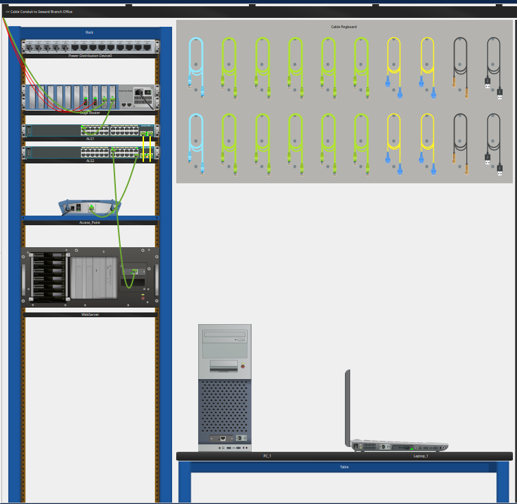
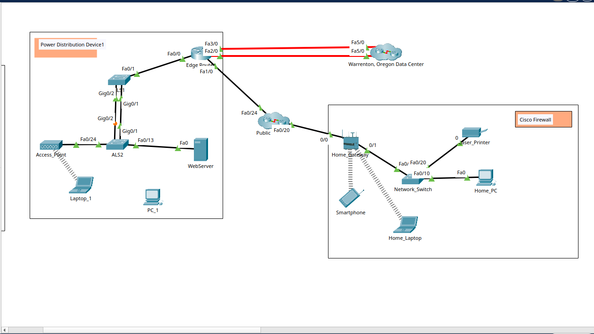
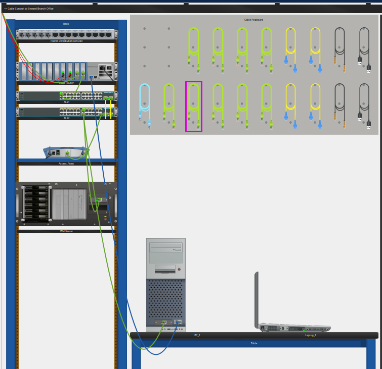
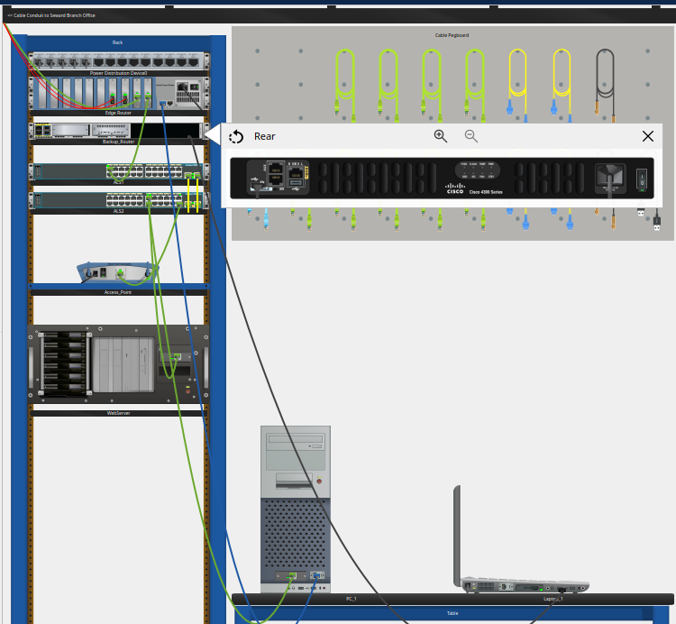
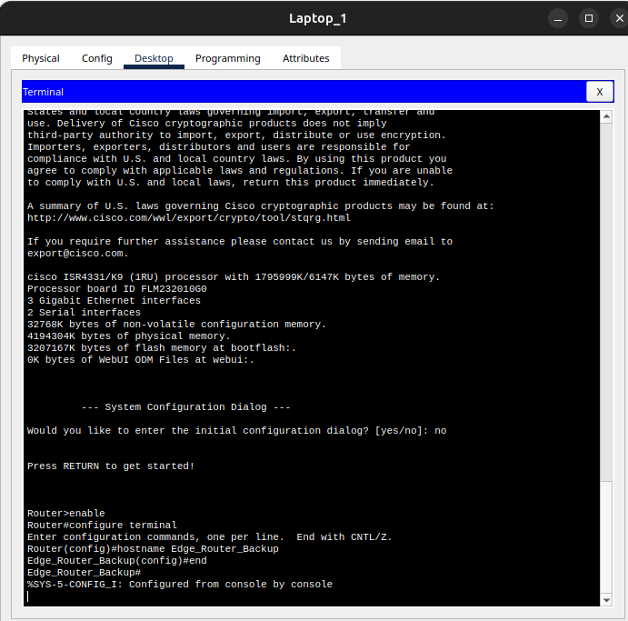
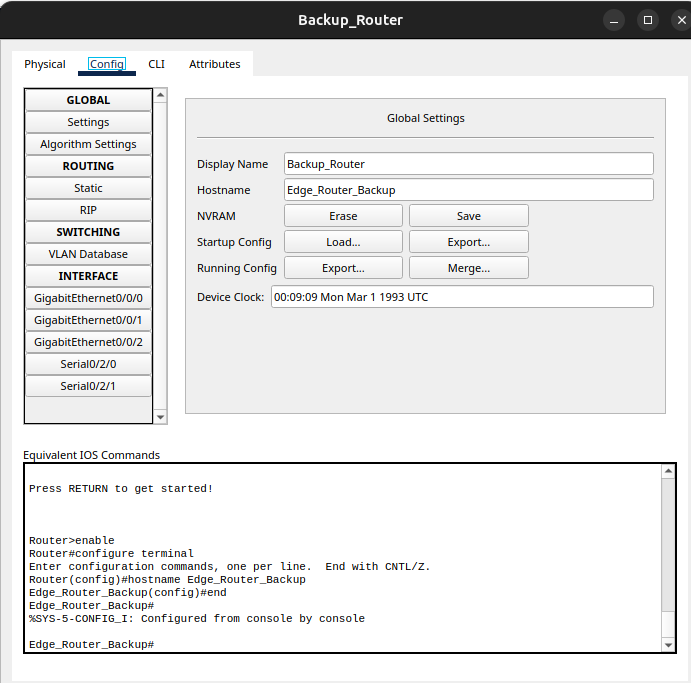

# Lab 1.0.5 — Packet Tracer Logical and Physical Mode Exploration

**Course:** CCNAv7: Switching, Routing, and Wireless Essentials (SRWE)  
**Module:** 1  
**Activity:** 1.0.5  
**Status:** Completed (learner-confirmed)  
**Environment:** Cisco Packet Tracer

## 1. Objectives

- Identify device and connection categories in the Packet Tracer interface.
- Compare the Logical and Physical workspaces.
- Inspect equipment installed in a branch office wiring closet.
- Connect end devices to network devices using Ethernet, serial console, and USB console cables.
- Configure an IOS hostname and distinguish it from the Packet Tracer display name.

## 2. Environment and Topology

The activity uses a branch office in Seward with a wiring closet containing a rack, cable pegboard, table, and shelf. The rack includes an `Edge_Router`, switches `ALS1` and `ALS2`, an `Access_Point`, and a `WebServer`. `PC_1` and `Laptop_1` are located on the table. A `Backup_Router` is installed during the activity.

### Observed connections

| Source | Destination | Medium / purpose | Evidence |
|---|---|---|---|
| ALS1 | ALS2 | Wired Ethernet links | Logical topology |
| Access_Point | ALS2 | Wired Ethernet | Logical topology |
| WebServer | ALS2 | Wired Ethernet | Logical topology |
| Laptop_1 | Access_Point | Wireless | Logical topology |
| PC_1 FastEthernet0 | ALS2 available FastEthernet port | Copper straight-through / network traffic | Physical workspace |
| PC_1 RS232 | Edge_Router Console | Console cable / local management | Physical workspace |
| Laptop_1 USB | Backup_Router USB Console | USB cable / local management | Terminal access confirmed in Part 5 |

The exact ALS2 FastEthernet port used for `PC_1` is not legible in the supplied screenshot. No IP addressing table was provided or required by the shared instructions.

## 3. Part 1 — Explore the Bottom Toolbar

The **Network Devices** category contains six subcategories:

1. Routers
2. Switches
3. Hubs
4. Wireless Devices
5. Security
6. WAN Emulation

Other bottom-toolbar categories described in the activity include End Devices, Components, Connections, Miscellaneous, and Multiuser Connection.

**Answer:** Routers, Switches, Hubs, Wireless Devices, Security, and WAN Emulation.

> No screenshot was provided specifically for Part 1.

## 4. Part 2 — Explore Devices in a Wiring Closet

The Physical workspace shows the placement of devices in the branch office wiring closet, including the rack, cable pegboard, and table.



*Figure 1 — Physical workspace showing rack-mounted devices, cable pegboard, PC_1, and Laptop_1.*

The Logical workspace shows the network topology and relationships between devices.



*Figure 2 — Logical topology with wired links and the wireless connection to Laptop_1.*

### Activity answers

**d. Which devices have wired connections to ALS2?**  
`ALS1`, `Access_Point`, and `WebServer`.

**e. Which device connects to Access_Point?**  
`Laptop_1`, through a wireless connection.

**f. Where is the device connected to Access_Point physically located?**  
`Laptop_1` is on the table in the branch office wiring closet.

### Technical observation

The access point connects wireless clients to the wired network. The physical and logical views describe the same environment from different perspectives: equipment placement versus network connectivity.

## 5. Part 3 — Connect End Devices to Network Devices

The cable pegboard described in the activity contains two console cables, ten copper straight-through cables, four fiber cables, two coaxial cables, and two USB cables.

The following connections were made:

1. Select a **Copper Straight-Through** cable from the pegboard.
2. Connect `PC_1` **FastEthernet0** to an available FastEthernet port on `ALS2`.
3. Select a **Console** cable.
4. Connect `PC_1` **RS232** to the **Console** port on `Edge_Router`.



*Figure 3 — Copper Ethernet cable from PC_1 to ALS2 and blue console cable from PC_1 to Edge_Router.*

### Ethernet versus console access

| Property | Ethernet connection | Console connection |
|---|---|---|
| Primary purpose | Network data communication | Local device management |
| PC interface | FastEthernet0 | RS232 |
| Network-device interface | Switch Ethernet port | Router Console port |
| IP connectivity required to access router CLI | Depends on remote management method | No |

The screenshot supports the presence of the connections. It does not show the Packet Tracer grading result.

## 6. Part 4 — Install a Backup Router

1. Inspect the equipment shelf.
2. Move `Backup_Router` into an empty rack position.
3. Inspect its rear panel and turn it on if necessary.
4. Connect a USB cable from its **USB Console** port to a USB port on `Laptop_1`.



*Figure 4 — Backup_Router mounted below Edge_Router; the rear-panel inspection view is open.*

The screenshot confirms the router's rack placement and rear-panel inspection. Successful USB console access is demonstrated in Part 5, rather than established by this image alone.

**Technical note:** USB console access is an out-of-band local management method and does not require an IP address on the router.

## 7. Part 5 — Configure a Hostname

From `Laptop_1 > Desktop > Terminal`, the router console session displayed the initial configuration dialog. The dialog was declined with `no`, followed by Enter to reach the IOS prompt.

### Cisco IOS commands executed

```cisco
Router> enable
Router# configure terminal
Router(config)# hostname Edge_Router_Backup
Edge_Router_Backup(config)# end
Edge_Router_Backup#
```



*Figure 5 — Terminal session from Laptop_1 showing the IOS prompt change to Edge_Router_Backup.*

The resulting prompt `Edge_Router_Backup#` verifies the active hostname. The console also displayed `%SYS-5-CONFIG_I: Configured from console by console`.



*Figure 6 — Packet Tracer Config tab: Display Name remains Backup_Router while Hostname is Edge_Router_Backup.*

### Display name versus hostname

| Field | Observed value | Meaning |
|---|---|---|
| Display Name | `Backup_Router` | Visual label in Packet Tracer |
| Hostname | `Edge_Router_Backup` | IOS device name reflected in the CLI prompt |

Changing the IOS hostname does **not** automatically change the Packet Tracer display name.

### Configuration persistence

The screenshots verify the active hostname but do not show a save to startup configuration. On IOS, the standard command for persisting a configuration is:

```cisco
Edge_Router_Backup# copy running-config startup-config
```

This is a reference command, **not** a command claimed to have been executed in this activity.

## 8. Verification and Results

| Check | Result | Basis |
|---|---|---|
| Network-device subcategories identified | Completed | Learner's Part 1 answer |
| Physical and logical views explored | Completed | Supplied screenshots |
| ALS2 wired neighbors identified | Completed | Logical topology |
| Laptop_1 wireless association identified | Completed | Logical topology |
| PC_1 Ethernet and console cables connected | Visually observed | Part 3 screenshot |
| Backup_Router installed in rack | Visually observed | Part 4 screenshot |
| Laptop_1 accessed backup router CLI | Confirmed | Part 5 terminal screenshot |
| IOS hostname changed | Confirmed | Terminal and Config tab screenshots |
| Packet Tracer Check Results score | Not provided | No grading screenshot supplied |

**Completion:** The learner confirmed that the lab was finished. The Packet Tracer assessment score was not provided and is not inferred.

## 9. Troubleshooting Notes

- **No Ethernet connectivity:** Confirm the cable endpoints, correct switch port, interface status, and device configuration.
- **No console output:** Check that the cable connects to the intended console interface and that the terminal settings match the device.
- **USB console does not respond:** Verify the router is powered on, the USB cable endpoints are correct, and the terminal session is using the appropriate console connection.
- **Hostname differs from the topology label:** Check the IOS `hostname` setting separately from Packet Tracer's Display Name.
- **Hostname is lost after reboot:** Check whether the running configuration was saved to startup configuration.

## 10. Lessons Learned

- Logical and Physical workspaces are complementary tools for understanding network topology and equipment placement.
- Copper straight-through cables support wired network connections; console and USB console cables support local device administration.
- Initial IOS configuration can be performed without IP connectivity through a console session.
- IOS hostnames and Packet Tracer display names are separate properties.
- A CLI prompt change is direct evidence that the hostname command took effect in the active configuration.

## 11. References

- Cisco Networking Academy — CCNAv7: Switching, Routing, and Wireless Essentials, Lab 1.0.5 (activity instructions supplied by the learner).
- Learner-provided Packet Tracer screenshots (Figures 1–6).

> This is an independently written lab report based on the learner's activity notes and screenshots, not a reproduction of the complete proprietary course activity.
