# Lab 1.1.7 — Packet Tracer: Basic Switch Configuration (Physical Mode)

**Course:** CCNAv7 — Switching, Routing, and Wireless Essentials (SRWE)  
**Environment:** Cisco Packet Tracer, Physical Mode; Cisco Catalyst WS-C3650-24PS switch (IOS XE 16.3.2), PC-A

## Objective

Explore a Catalyst switch's default state, install and cable a switch in the physical workspace, configure basic device security and management addressing, verify dual-stack connectivity and remote access, and save the configuration.

> **Scope:** The steps and observations below are based on the actual Packet Tracer exercise and its screenshots. Production security guidance and automation examples are explicitly separated from the graded lab configuration. The Packet Tracer activity's official numerical score was not provided.

## Environment and Topology

- **Switch:** S1, simulated Cisco Catalyst WS-C3650-24PS, IOS XE 16.3.2.
- **End device:** PC-A, FastEthernet0.
- **Data link:** PC-A FastEthernet0 ↔ S1 GigabitEthernet1/0/6, copper straight-through.
- **Initial management link:** PC-A RS232 ↔ S1 Console; removed at the end of the exercise.
- **Physical installation:** S1 mounted in the Main Wiring Closet rack.
- **Management VLAN:** VLAN 99, default name `VLAN0099` (the graded activity required this name).

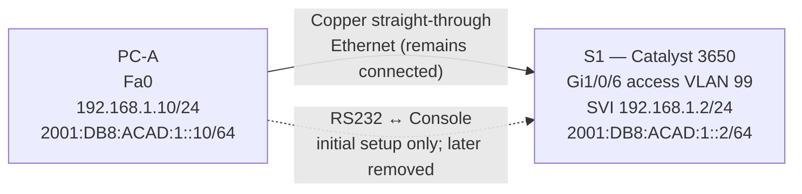

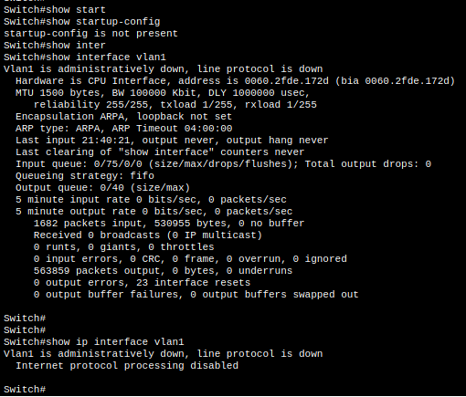

### Addressing table

| Device | Interface | IPv4 / Mask | IPv6 / Prefix | Default gateway |
|---|---|---|---|---|
| S1 | VLAN 99 SVI | `192.168.1.2/24` | `2001:DB8:ACAD:1::2/64` | `192.168.1.1` |
| S1 | VLAN 99 link-local | — | `FE80::2` | — |
| PC-A | FastEthernet0 | `192.168.1.10/24` | `2001:DB8:ACAD:1::10/64` | `192.168.1.1`, `FE80::1` |

The gateway addresses were configured for the exercise; no functioning gateway router was demonstrated. The PC-A addresses were used successfully during the lab, although the official addressing table was not shared separately.

## Lab Mind Map

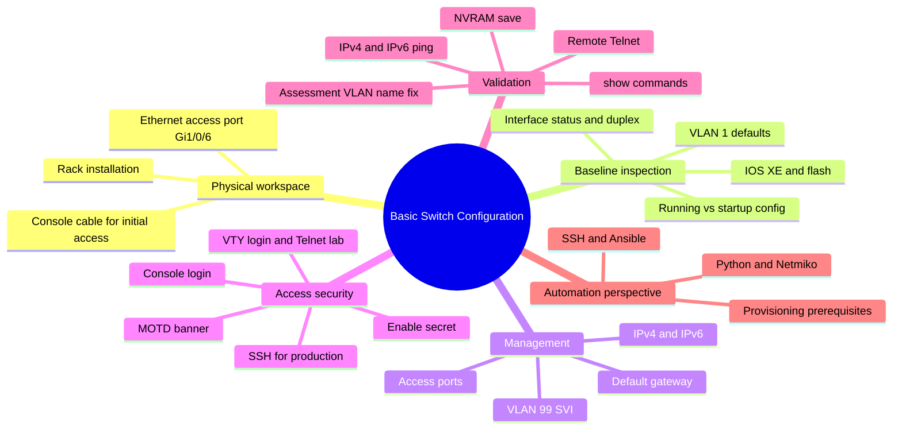

## Workflow Overview

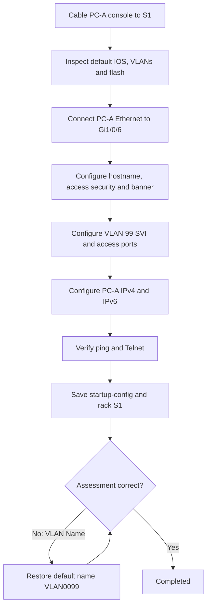

## Part 1 — Inspect the Default Switch Configuration

Access `PC-A > Desktop > Terminal` over the console cable. Decline the initial setup dialog and enter privileged EXEC mode:

```cisco
Switch> enable
Switch# show running-config
Switch# show startup-config
Switch# show interface vlan1
Switch# show ip interface vlan1
Switch# show version
Switch# show interface gigabitEthernet1/0/6
Switch# show vlan
Switch# show flash:
```

### Observed baseline

| Inspection | Observed result |
|---|---|
| GigabitEthernet interfaces | 28: `Gi1/0/1–24` and `Gi1/1/1–4` |
| VTY lines initially shown | `line vty 0 4` |
| Startup configuration | `startup-config is not present` |
| Initial VLAN 1 SVI | No IP address; administratively down/down |
| VLAN 1 SVI MAC | `0060.2fde.172d` |
| IOS XE | `16.3.2` |
| System image | `cat3k_caa-universalk9.16.03.02.SPA.bin` |
| Base Ethernet MAC | `00:60:2F:DE:17:2D` |
| Gi1/0/6 after cabling | Up/up, `100Mb/s`, full-duplex; MAC `000c.8589.1806` |
| VLAN 1 default name and type | `default`, `enet` |
| Initial VLAN membership | All 28 GigabitEthernet ports in VLAN 1 |
| Flash files observed | IOS image and `vlan.dat` |

The 100 Mb/s operational link speed is consistent with the PC-A FastEthernet adapter, despite the switch port being named GigabitEthernet.

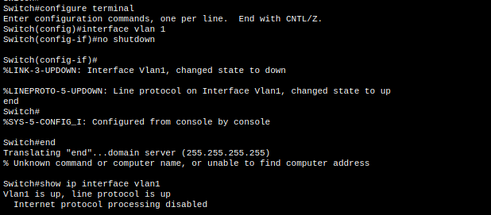
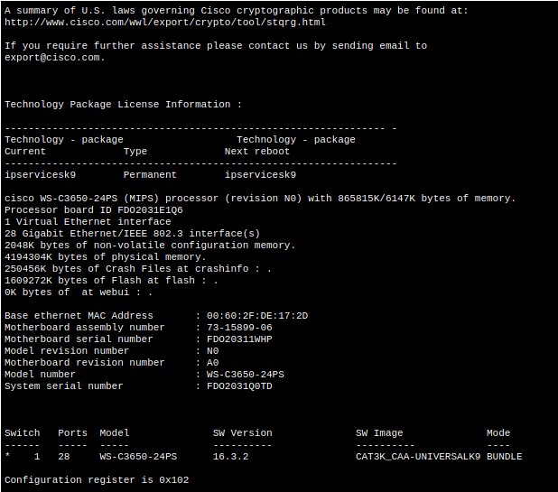
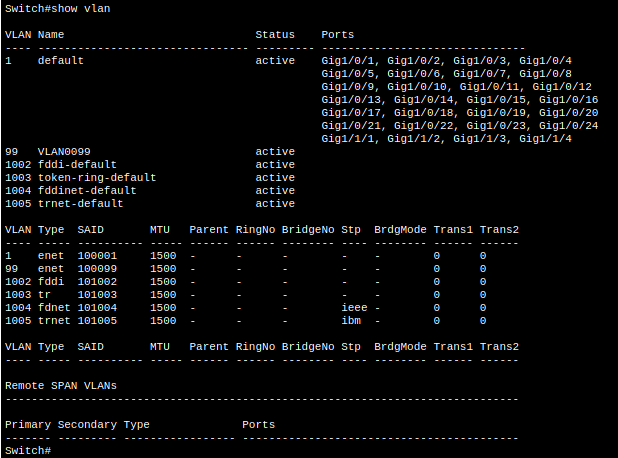
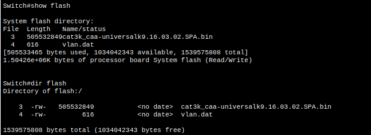

### Bring up the default SVI for observation

After connecting PC-A FastEthernet0 to S1 Gi1/0/6, the physical port changed to up/up. VLAN 1 remained administratively down until:

```cisco
Switch# configure terminal
Switch(config)# interface vlan 1
Switch(config-if)# no shutdown
Switch(config-if)# end
Switch# show ip interface vlan1
```

Observed result: `Vlan1 is up, line protocol is up`, but IP processing remained disabled because no IP address was configured.

## Part 2 — Configure S1 and PC-A

### Manual configuration script (lab-specific)

The full reusable command sequence is in [`configs/s1-lab-configuration.txt`](configs/s1-lab-configuration.txt). It uses **password placeholders**; supply only the credentials specified in your own lab. The actual exercise used lab-only credentials and Telnet, which should not be copied into production configurations.

```cisco
Switch# configure terminal
Switch(config)# hostname S1
S1(config)# no ip domain-lookup
S1(config)# service password-encryption
S1(config)# enable secret <LAB_ENABLE_SECRET>
S1(config)# banner motd #
Unauthorized access is strictly prohibited.
#
S1(config)# vlan 99
S1(config-vlan)# no name
S1(config-vlan)# exit
S1(config)# interface vlan 99
S1(config-if)# ip address 192.168.1.2 255.255.255.0
S1(config-if)# ipv6 address 2001:DB8:ACAD:1::2/64
S1(config-if)# ipv6 address FE80::2 link-local
S1(config-if)# no shutdown
S1(config-if)# exit
S1(config)# interface range GigabitEthernet1/0/1 - 24
S1(config-if-range)# switchport mode access
S1(config-if-range)# switchport access vlan 99
S1(config-if-range)# exit
S1(config)# interface range GigabitEthernet1/1/1 - 4
S1(config-if-range)# switchport mode access
S1(config-if-range)# switchport access vlan 99
S1(config-if-range)# exit
S1(config)# ip default-gateway 192.168.1.1
S1(config)# line console 0
S1(config-line)# password <LAB_CONSOLE_PASSWORD>
S1(config-line)# login
S1(config-line)# logging synchronous
S1(config-line)# exit
S1(config)# line vty 0 15
S1(config-line)# password <LAB_VTY_PASSWORD>
S1(config-line)# login
S1(config-line)# transport input telnet
S1(config-line)# end
S1# copy running-config startup-config
```

**Important:** The assessment required the default VLAN 99 name `VLAN0099`. Naming it `Management` was accepted by IOS but failed the activity's exact-match assessment. `no name` restored the default VLAN name.

### Key operational observations

- VLAN 99 was initially **up/down** because no active access port belonged to it.
- After the access ports were assigned to VLAN 99, the SVI became **up/up** and VLAN 1's line protocol went down.
- Gi1/0/6 remained **up/up**; VLAN 99 used `192.168.1.2/24`.
- `service password-encryption` caused line passwords to be stored as reversible Cisco Type 7 values. `enable secret` appeared as a Type 5 hash in this simulated IOS version.

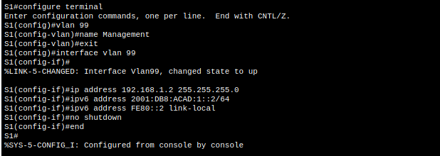
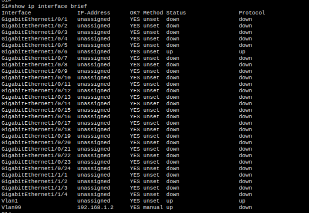
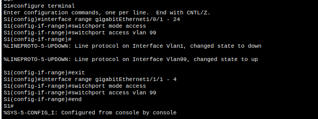
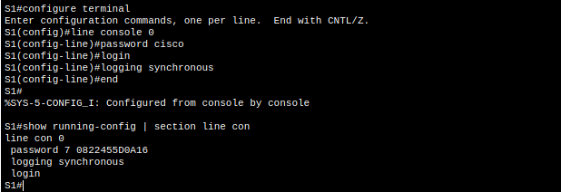
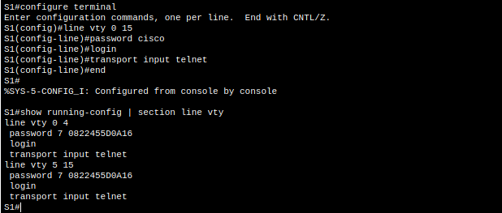

### Configure PC-A

In `PC-A > Desktop > IP Configuration`, use the addressing table above. Verify with `ipconfig /all` in the Packet Tracer command prompt.

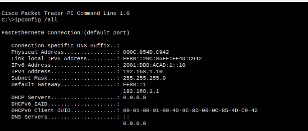

## Part 3 — Verify Connectivity and Management

### Verification commands

```cisco
S1# show vlan brief
S1# show ip interface brief
S1# show ipv6 interface brief
S1# show interface vlan 99
S1# show running-config | section line vty
S1# show startup-config
```

The actual `show interface vlan 99` output showed **up/up**, MAC `0060.2fde.1701`, MTU 1500 bytes, and bandwidth `100000 Kbit/s` (a reported SVI metric, not the speed of a physical uplink).

### PC-A connectivity tests

```text
C:\> ping 192.168.1.2
C:\> ping 2001:DB8:ACAD:1::2
C:\> telnet 192.168.1.2
```

| Test | Observed result |
|---|---|
| IPv4 ping to `192.168.1.2` | 4 sent, 4 received, 0% loss |
| IPv6 ping to `2001:DB8:ACAD:1::2` | 4 sent, 4 received, 0% loss |
| Telnet to `192.168.1.2` | Successful authentication; `S1>` prompt displayed |
| Privileged EXEC via Telnet | `S1#` prompt reached |
| Startup configuration | `show startup-config` returned saved configuration |
| Rack installation | S1 mounted in rack; Ethernet connection retained |
| Console cable | Successfully removed after initial setup |

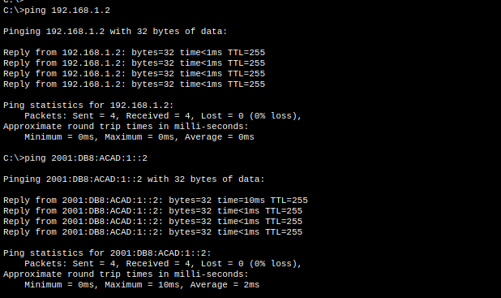
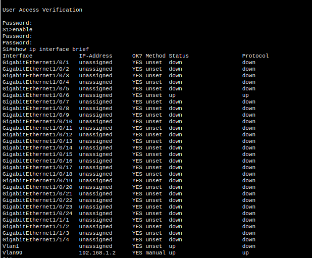
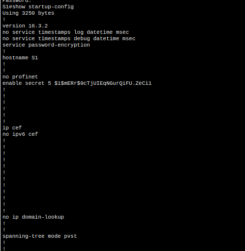
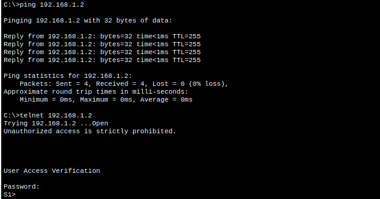

> The rack screenshot was captured before the final console cable removal. The learner subsequently confirmed removal; the final console-free image was visible in the conversation but is not included as a separate source file in this package.

## Assessment Issue and Resolution

The assessment initially flagged **S1 → VLANs → VLAN 99 → VLAN Name** as incorrect. The custom name `Management` was the mismatch, despite being technically valid. Restoring the default name resolved the assessment, and the learner confirmed the activity completed.

```cisco
S1# configure terminal
S1(config)# vlan 99
S1(config-vlan)# no name
S1(config-vlan)# end
S1# show vlan brief
S1# copy running-config startup-config
```

Expected name after correction: `VLAN0099`.

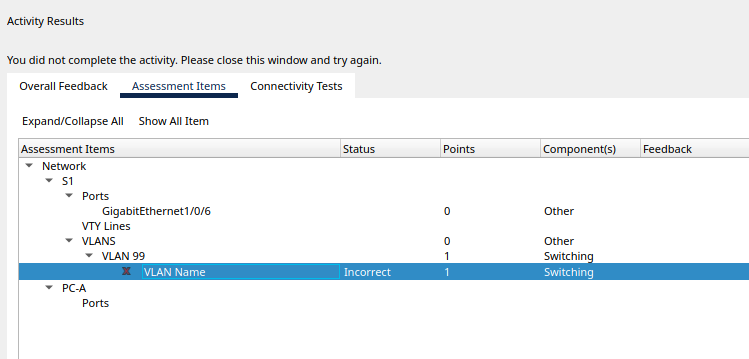

**Lesson:** A simulator's assessment may check exact expected values even when an alternative configuration is technically functional. Always compare the assessment feedback with the original lab requirements before changing working network parameters.

## Reflection Questions

**1. Why is a VTY password required?**  
A VTY password authenticates remote users when line-password login is configured, reducing unauthorized access to the switch CLI. Production networks should use SSH and stronger centralized or local authentication rather than relying on a shared Telnet line password.

**2. Why use a VLAN other than VLAN 1?**  
A dedicated management VLAN helps organize management traffic and supports access-control policies independently from the default VLAN. Merely renumbering the VLAN does **not** provide isolation or security by itself; effective segmentation requires appropriate port assignment, routing and access controls.

**3. How can passwords be prevented from crossing the network in plaintext?**  
Use **SSH rather than Telnet** for remote administration. SSH encrypts the management session, including authentication exchanges. `service password-encryption` affects stored line passwords, **not** traffic in transit.

## Production Security Perspective — Prefer SSH

The Packet Tracer lab intentionally demonstrated Telnet; **do not use Telnet for production device administration**. On supported Cisco IOS/IOS XE platforms, use SSHv2 with strong unique credentials or AAA, restricted management-plane access, and preferably an isolated management network. Protect secrets using an approved secret manager and avoid storing live passwords in Git.

**Illustrative SSH migration** (not part of the graded activity; exact syntax/features depend on IOS and organizational policy):

```cisco
configure terminal
ip domain-name example.internal
username netadmin privilege 15 secret <STRONG_UNIQUE_SECRET>
crypto key generate rsa modulus 2048
ip ssh version 2
line vty 0 15
 login local
 transport input ssh
end
```

Prerequisites include reachable management IP, supported crypto features and correct SSH key generation. Restrict access with management ACLs and use centralized AAA where available. Changing `transport input telnet` to SSH without preparing the prerequisites can lock out remote management; retain an out-of-band recovery path.

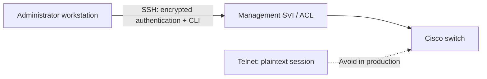

## Automation Perspective — Objective Summary

**Yes: the same recurring configuration can be automated on supported real or virtual Cisco devices.** Automation requires initial management reachability and authentication, or a provisioning mechanism such as zero-touch provisioning (ZTP) on supported platforms.

| Approach | Typical use | Caveat |
|---|---|---|
| Ansible + `cisco.ios` | Repeatable configuration, compliance and verification across inventories | Requires supported access, credentials and tested playbooks |
| Python + Netmiko | SSH-based command execution and collection of `show` outputs | Requires error handling, logging and credential hygiene |
| NETCONF / RESTCONF | Model-driven configuration and telemetry | Feature/platform support varies |
| ZTP / controller-based provisioning | Bootstrap devices at scale | Depends on platform, image and provisioning infrastructure |

**Minimal illustrative Ansible example** (not executed in Packet Tracer):

```yaml
---
- name: Configure switch management
  hosts: switches
  gather_facts: false
  tasks:
    - name: Configure management SVI
      cisco.ios.ios_config:
        parents: interface Vlan99
        lines:
          - ip address 192.168.1.2 255.255.255.0
          - no shutdown
```

This example assumes an Ansible inventory, `cisco.ios` collection, appropriate network connection settings, and reachable devices. Do not use the same management IP on multiple switches: assign per-device variables. Packet Tracer is primarily an educational simulator and does not reproduce the full automation API/SSH behavior of production IOS XE. Cisco Modeling Labs, compatible GNS3/EVE-NG images, or real devices are more suitable for hands-on automation practice.

**Automation principle:** automate **desired state, validation and drift detection**, not just the rapid replay of CLI commands.

## Troubleshooting Checklist

| Symptom | Check |
|---|---|
| PC-A cannot ping S1 | Ethernet cable, Gi1/0/6 state, PC-A IP/subnet, VLAN 99 port membership, SVI state |
| VLAN 99 is `up/down` | VLAN exists and has an active eligible port; spanning-tree and autostate conditions |
| IPv4 works, IPv6 fails | IPv6 addresses/prefix, interface state, neighbor discovery and platform support |
| Telnet fails | SVI reachability, VTY authentication, `transport input`, credentials |
| `startup-config is not present` | Save `running-config` to `startup-config` |
| VLAN Name assessment incorrect | Restore `VLAN0099` using `vlan 99` / `no name` |
| Unrecognized command triggers DNS lookup | Use `no ip domain-lookup` in global configuration |

## Evidence Index

All screenshots are in [`screenshots/`](screenshots/). The numbered filenames follow the configuration and verification sequence. The accompanying CLI files are in [`configs/`](configs/).

## Cleanup / Reset

The final lab state retains the Ethernet connection and saved configuration. The console cable was removed. To repeat the activity, use a fresh authorized Packet Tracer activity copy rather than resetting an assessed project in place.

## Lessons Learned

- Console access is useful for bootstrap; a correctly configured management SVI enables remote management.
- VLAN membership and physical link state affect whether an SVI becomes operational.
- Dual-stack connectivity must be verified separately for IPv4 and IPv6.
- The `running-config` and `startup-config` are distinct; save changes deliberately.
- Telnet may appear in legacy teaching labs, but SSH is the appropriate production default.
- Exact-match assessment requirements can differ from otherwise valid network design choices.
- Repetitive CLI operations are strong candidates for automation once device behavior is understood.

## References

- Cisco Networking Academy — CCNAv7 SRWE, Packet Tracer Lab 1.1.7 (learner-provided lab observations and screenshots).
- Cisco IOS XE command-line documentation for the relevant platform and release (consult the matching release before production deployment).
- Ansible `cisco.ios` collection documentation for automation implementation.
