# Lab 1.3.6 — Packet Tracer: Configure SSH

**Course:** CCNAv7 — Switching, Routing, and Wireless Essentials (SRWE)  
**Module:** 1 — Basic Device Configuration  
**Platform:** Cisco Packet Tracer  
**Result:** **Completed — 100%** (confirmed by the learner after correcting the SSH username)  
**Lab date:** 2026-10-28

## Objective

Secure remote management of switch **S1** by protecting stored line passwords, generating RSA keys, creating a local SSH account, and restricting Virtual Teletype (VTY) lines to **SSH only**. Confirm that Telnet is no longer usable, SSH authentication succeeds, and the final configuration is saved.

> **Scope:** This is a documented educational lab, not a production-ready security baseline. The supplied activity uses a weak demonstration password and a 1024-bit RSA key; do not reuse these values on real infrastructure.

## Environment and Topology

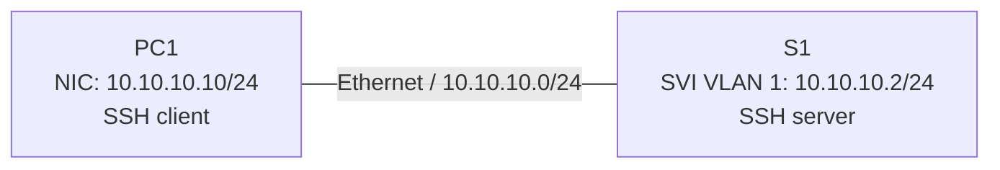

| Device | Interface | IPv4 address | Subnet mask | Role |
|---|---|---|---|---|
| S1 | VLAN 1 | `10.10.10.2` | `255.255.255.0` | Managed switch |
| PC1 | NIC | `10.10.10.10` | `255.255.255.0` | Management workstation |

No default gateway or physical switch port number was specified in the supplied lab guide. The switch was initially reachable through Telnet from PC1.

## Learning Map

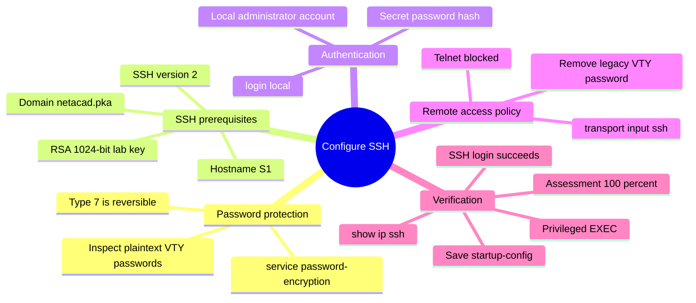

## Prerequisites and Initial State

The supplied activity starts with Telnet access enabled and the management SVI configured. The initial running configuration displayed plaintext passwords on VTY lines 0–4 and 5–15:

```cisco
interface Vlan1
 ip address 10.10.10.2 255.255.255.0
!
line vty 0 4
 password cisco
 login
line vty 5 15
 password cisco
 login
```

Initial access from **PC1 > Desktop > Command Prompt**:

```text
telnet 10.10.10.2
```

The lab specified `cisco` for both the initial user EXEC password and the privileged EXEC password. Before changing anything, the running configuration was saved as a rollback point:

```cisco
copy running-config startup-config
show running-config
```

**Important:** Restarting to recover the previous startup configuration is useful only **before** saving the modified configuration. Once the new running configuration is copied to startup-config, the original baseline is overwritten.

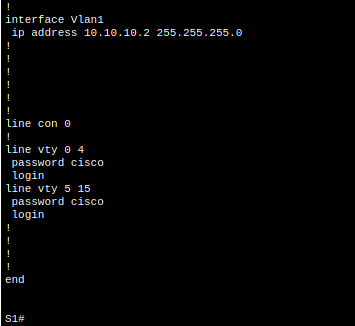

## Configuration Procedure

### Part 1 — Protect Stored Passwords

In privileged EXEC mode, enter global configuration mode and enable password obfuscation:

```cisco
configure terminal
service password-encryption
end
show running-config
```

The subsequent output showed both VTY passwords in Cisco Type 7 format rather than plaintext:

```cisco
line vty 0 4
 password 7 0822455D0A16
 login
line vty 5 15
 password 7 0822455D0A16
 login
```

Cisco Type 7 is **reversible obfuscation**, not strong encryption. This command does **not** encrypt Telnet traffic.

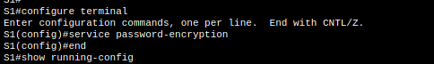

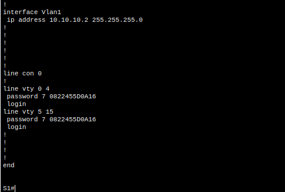

### Part 2 — Configure SSH Cryptography

The activity required the domain `netacad.pka` and a **1024-bit RSA key**:

```cisco
configure terminal
ip domain-name netacad.pka
crypto key generate rsa
```

At the key-size prompt, enter:

```text
1024
```

Then verify the server:

```cisco
end
show ip ssh
```

**Observed:** The switch generated the RSA keys successfully and initially reported `SSH Enabled - version 1.99`, a compatibility indication for SSHv1/SSHv2 rather than a separate SSH protocol version.

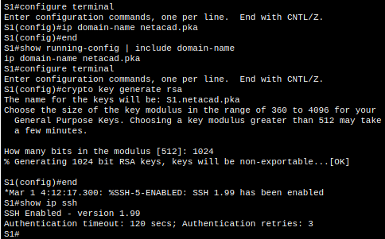

### Part 2 — Create Local Account and Enforce SSHv2

The English assessment required the exact username **`administrator`**. The initial translated username `administrador` authenticated successfully but failed the assessment; the correction is described in [Troubleshooting](#troubleshooting-and-assessment-correction).

Final intended configuration:

```cisco
configure terminal
username administrator secret cisco
ip ssh version 2
line vty 0 15
 login local
 transport input ssh
 no password
end
```

| Command | Purpose |
|---|---|
| `username administrator secret cisco` | Creates a local account with a hashed secret |
| `ip ssh version 2` | Disables SSHv1 compatibility |
| `login local` | Uses the local username database for VTY authentication |
| `transport input ssh` | Allows only SSH on VTY lines |
| `no password` | Removes the previous VTY line password |

Verify:

```cisco
show ip ssh
show running-config | include username
show running-config | section line vty
```

**Observed:** `SSH Enabled - version 2.0`, the local account stored with a Type 5 secret hash, and both VTY ranges configured with `login local` and `transport input ssh`.

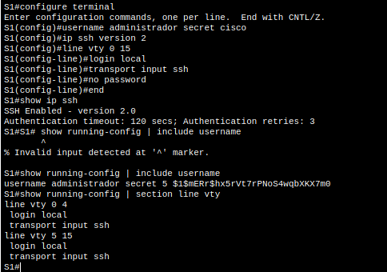

## Verification and Observed Results

### Connection Flow

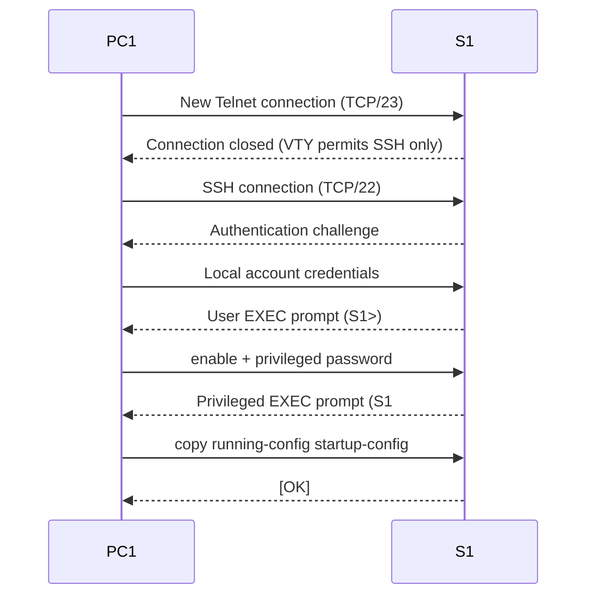

On PC1, the Telnet test was rejected:

```text
telnet 10.10.10.2
Trying 10.10.10.2 ...Open
[Connection to 10.10.10.2 closed by foreign host]
```

The initial SSH test succeeded with the translated account, establishing that SSH transport and local authentication worked:

```text
ssh -l administrador 10.10.10.2
Password:
S1>
```

The privileged EXEC prompt was reached and the configuration was saved:

```cisco
enable
copy running-config startup-config
```

The device responded with `Building configuration...` and `[OK]`. After the account-name correction, the learner confirmed **100%** in the Packet Tracer assessment. A separate post-correction SSH login capture using `administrator` was not supplied.

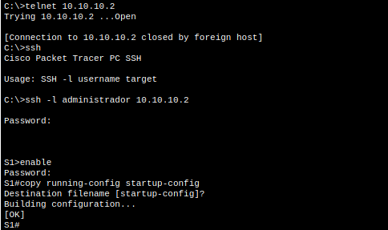

### Verification Matrix

| Check | Observed outcome |
|---|---|
| IP domain name | `netacad.pka` configured |
| RSA modulus | 1024 bits generated successfully |
| SSH server | SSH 2.0 enabled after configuration |
| VTY authentication | `login local` on lines 0–15 |
| VTY transport | SSH only |
| Telnet reconnect | Closed by remote host |
| SSH reconnect | Successful with initial local account |
| Privileged EXEC | `S1#` reached |
| Save configuration | `[OK]` |
| Official assessment | **100%**, confirmed by learner |

## Troubleshooting and Assessment Correction

### Local Username Mismatch

The translated instructions referred to `administrador`, and the initial configuration used:

```cisco
username administrador secret cisco
```

Although this account worked over SSH, **Assessment Items > User Names > (deprecated) Username** reported **Incorrect (20 points)**. The assessment expected the literal English username `administrator`.

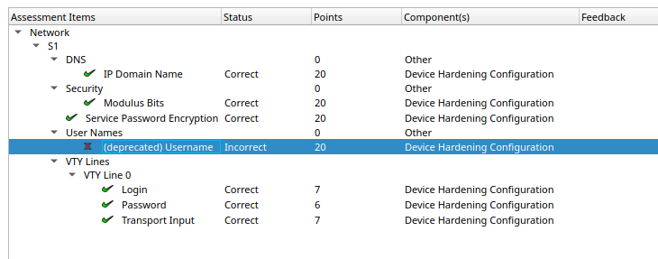

The account was corrected without first removing the working login:

```cisco
configure terminal
username administrator secret cisco
end
show running-config | include username
```

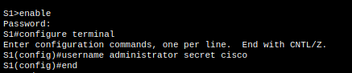

After confirming the correct account existed, the translated account was removed:

```cisco
configure terminal
no username administrador
end
show running-config | include username
```

The final observed username listing contained only `administrator`. The learner then confirmed the assessment result of **100%**.

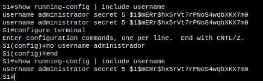

**Recommended final persistence check:** After any correction made *after* an earlier `copy running-config startup-config`, run that save command again and test a new SSH session using `ssh -l administrator 10.10.10.2`. The provided screenshots do not independently show this final post-correction save or login.

### Common Troubleshooting Checks

| Symptom | Check |
|---|---|
| `SSH Disabled` | Verify hostname, `ip domain-name`, and RSA keys |
| SSH connects but login fails | Check exact local username and `login local` |
| Telnet still works | Check `transport input ssh` across all relevant VTY lines |
| CLI reports invalid input | Do not type the `S1#` prompt as part of a command |
| Assessment fails despite working SSH | Compare literal usernames and other expected strings with the original assessment |
| Configuration disappears after reload | Check whether changes were saved to startup-config |

## Security Considerations: Lab vs Production

| Topic | Packet Tracer lab | Production recommendation |
|---|---|---|
| Remote protocol | SSHv2 | SSHv2 with current supported algorithms |
| RSA key | 1024 bits (activity requirement) | At least 2048 bits where supported; follow organizational cryptographic policy |
| Local secret | `cisco` (activity requirement) | Unique, strong credentials; preferably AAA with centralized identity |
| Password storage | Type 7 for line passwords; Type 5 observed for local secret | Prefer stronger supported password-hashing mechanisms and secret management |
| VTY access | SSH only | SSH only plus management ACLs and network segmentation |
| Management VLAN | VLAN 1 (given topology) | Dedicated, access-controlled management network when practical |
| Monitoring | Manual verification | Authentication logs, configuration backup, change review and monitoring |

**SSH protects credentials and management traffic in transit.** `service password-encryption` only obfuscates some passwords stored in device configuration. SSH should replace Telnet in production; do not infer that SSH alone solves authorization, password policy, or management-plane exposure.

## Manual Configuration Script

A reusable educational command sequence is provided at [`configs/s1-ssh-lab.cli`](configs/s1-ssh-lab.cli). It intentionally contains the weak **lab-only** credentials and assumes the initial S1 management IP, hostname, and console/Telnet access already exist. Apply commands in the correct IOS mode and answer the RSA modulus prompt interactively.

For verification, see [`configs/verification-commands.txt`](configs/verification-commands.txt).

## Automation Perspective

This activity was configured manually in Packet Tracer. On supported real or virtual IOS/IOS XE platforms, the same workflow can be automated after a secure management path exists:

| Option | Typical use | Caveat |
|---|---|---|
| Ansible (`cisco.ios`) | Consistent configuration across an inventory | Requires reachable devices, credentials and collection compatibility |
| Python + Netmiko | SSH-based command execution and verification | Must handle prompts, failures and secrets safely |
| NETCONF / RESTCONF | Model-driven configuration and state queries | Depends on device/platform feature support |
| Zero-Touch Provisioning | Initial deployment of supported hardware | Requires a controlled provisioning environment |

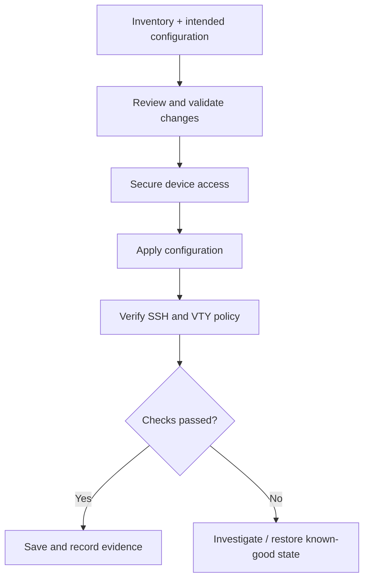

**Practical boundary:** Packet Tracer does not reproduce all automation APIs or platform behaviors available on real Cisco IOS XE devices. Test automated workflows on supported lab images or hardware, and never place real credentials in Git.

## Evidence / Screenshots

| File | Evidence |
|---|---|
| [`01-initial-plaintext-vty.png`](screenshots/01-initial-plaintext-vty.png) | Initial plaintext VTY passwords |
| [`02-password-encryption-command.png`](screenshots/02-password-encryption-command.png) | Enabling password obfuscation |
| [`03-encrypted-vty-passwords.png`](screenshots/03-encrypted-vty-passwords.png) | Type 7 passwords after change |
| [`04-domain-rsa-ssh-enabled.png`](screenshots/04-domain-rsa-ssh-enabled.png) | Domain, RSA key generation and SSH 1.99 status |
| [`05-local-user-ssh-vty.png`](screenshots/05-local-user-ssh-vty.png) | Local user, SSHv2 and VTY configuration |
| [`06-telnet-rejected-ssh-verified-saved.png`](screenshots/06-telnet-rejected-ssh-verified-saved.png) | Telnet failure, SSH login and save |
| [`07-assessment-username-mismatch.png`](screenshots/07-assessment-username-mismatch.png) | Incorrect username assessment item |
| [`08-correct-username-added.png`](screenshots/08-correct-username-added.png) | Correct account created |
| [`09-incorrect-username-removed.png`](screenshots/09-incorrect-username-removed.png) | Old account removed |

## Cleanup / Reset

Keep the final SSH configuration for the completed activity. For a repeatable lab reset, restore a separately retained known-good baseline; do not assume a power cycle restores the initial activity once startup-config has been overwritten. Avoid deleting the only working SSH account while connected remotely.

## Lessons Learned

1. Telnet transmits management data without encryption; SSH protects the remote session.
2. `service password-encryption` obscures configuration strings but does not secure network traffic.
3. RSA keys, an IP domain name, local authentication, and VTY transport policy are distinct configuration requirements.
4. Successful network operation and successful Packet Tracer assessment are different checks: exact expected strings can matter.
5. Save only after validating the intended final configuration, and verify persistence after later corrections.

## References

- Cisco Networking Academy — *CCNAv7: Switching, Routing, and Wireless Essentials*, Packet Tracer activity 1.3.6, **Configure SSH** (learner-provided lab instructions).
- Cisco IOS command-line help (`?`) and device verification commands used during the exercise.

*Educational documentation. All addresses and passwords above belong to the simulated lab environment.*
