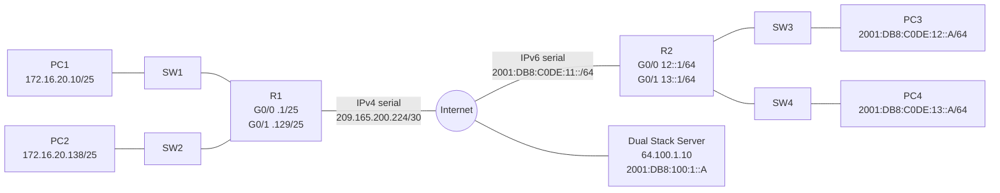
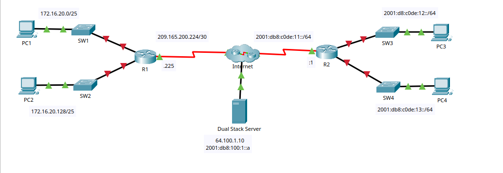
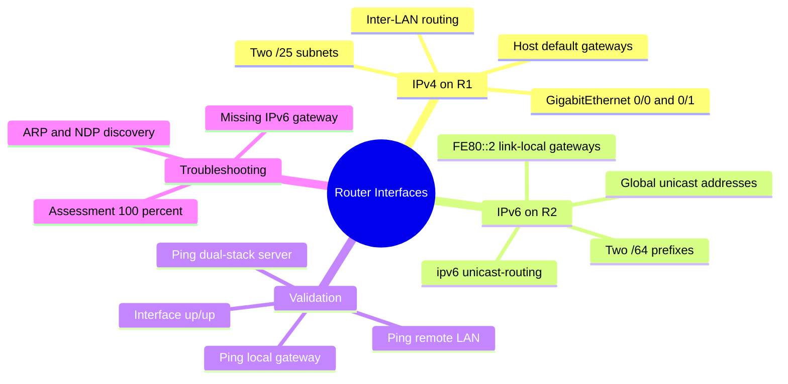
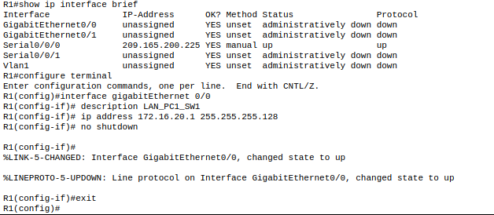
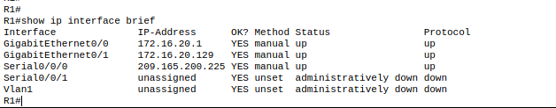
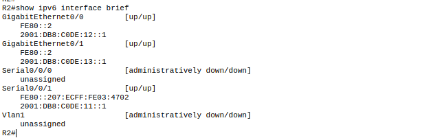

# Lab 1.4.7 — Packet Tracer: Configure Router Interfaces

**Course:** CCNAv7 — Switching, Routing, and Wireless Essentials (SRWE)  
**Environment:** Cisco Packet Tracer; routers R1 and R2, four access switches, four PCs, WAN/Internet segment, dual-stack server

## Objective

Configure IPv4 on two R1 LAN interfaces and IPv6 on two R2 LAN interfaces, assign host addresses and default gateways, and verify inter-LAN and external connectivity through a dual-stack server. The serial interfaces were **preconfigured** by the activity and were not changed.

## Environment and Topology





### IPv4 addressing

| Device | Interface | IPv4/prefix | Default gateway |
|---|---|---|---|
| R1 | G0/0 | `172.16.20.1/25` | N/A |
| R1 | G0/1 | `172.16.20.129/25` | N/A |
| R1 | S0/0/0 | `209.165.200.225/30` | N/A (preconfigured) |
| PC1 | NIC | `172.16.20.10/25` | `172.16.20.1` |
| PC2 | NIC | `172.16.20.138/25` | `172.16.20.129` |
| Server | NIC | `64.100.1.10` | Not specified |

### IPv6 addressing

| Device | Interface | Global IPv6/prefix | Link-local / default gateway |
|---|---|---|---|
| R2 | G0/0 | `2001:DB8:C0DE:12::1/64` | `FE80::2` |
| R2 | G0/1 | `2001:DB8:C0DE:13::1/64` | `FE80::2` |
| R2 | S0/0/1 | `2001:DB8:C0DE:11::1/64` | Preconfigured; observed `FE80::207:ECFF:FE03:4702` |
| PC3 | NIC | `2001:DB8:C0DE:12::A/64` | `FE80::2` |
| PC4 | NIC | `2001:DB8:C0DE:13::A/64` | `FE80::2` |
| Server | NIC | `2001:DB8:100:1::A` | Not specified |

**Source nuance:** The translated addressing table displayed an unusual `።` character in place of the IPv6 `::` separator. The addresses above use valid IPv6 notation confirmed by the topology and CLI. The serial link-local value shown in the table differed from the observed preconfigured R2 serial interface; this lab did not require changing that interface.

## Learning Mind Map



## Prerequisites and Scope

- Packet Tracer activity `1.4.7-packet-tracer-configure-router-interfaces` with the provided topology.
- R1 and R2 reachable via their CLI; activity-provided user EXEC and privileged EXEC passwords were used interactively and are **not** embedded in the scripts.
- Serial connections, routing toward the Internet cloud, and the server were already prepared by the activity. Do not reset these components.
- Configuration examples below reproduce the intended lab changes, not a production baseline.

## Configuration Procedure

### Part 1 — IPv4 on R1

1. On **R1 > CLI**, use `enable` to enter privileged EXEC mode and inspect `show ip interface brief`.
2. Configure G0/0 toward SW1/PC1 and G0/1 toward SW2/PC2:

```cisco
configure terminal
interface GigabitEthernet0/0
 description LAN_PC1_SW1
 ip address 172.16.20.1 255.255.255.128
 no shutdown
exit
interface GigabitEthernet0/1
 description LAN_PC2_SW2
 ip address 172.16.20.129 255.255.255.128
 no shutdown
end
```

Reusable script: [`configs/r1-ipv4.cli`](configs/r1-ipv4.cli).

3. On **PC1 > Desktop > IP Configuration**, select Static and enter `172.16.20.10`, mask `255.255.255.128`, gateway `172.16.20.1`.
4. On **PC2**, enter `172.16.20.138`, mask `255.255.255.128`, gateway `172.16.20.129`.
5. On R1, confirm that G0/0, G0/1 and the preconfigured S0/0/0 show `up/up`.





**Packet flow:** PC1 recognizes that PC2 is outside `172.16.20.0/25`, sends its frame to the MAC address of R1 G0/0, and R1 routes the IPv4 packet out G0/1 toward `172.16.20.128/25`. The switches forward Ethernet frames; R1 performs Layer 3 forwarding.

### Part 2 — IPv6 on R2

1. On **R2 > CLI**, inspect `show ipv6 interface brief` and `show ip interface brief` before changes.
2. Enable IPv6 routing and configure the two LAN interfaces:

```cisco
configure terminal
ipv6 unicast-routing
interface GigabitEthernet0/0
 description LAN_PC3_SW3
 ipv6 address 2001:DB8:C0DE:12::1/64
 ipv6 address FE80::2 link-local
 no shutdown
exit
interface GigabitEthernet0/1
 description LAN_PC4_SW4
 ipv6 address 2001:DB8:C0DE:13::1/64
 ipv6 address FE80::2 link-local
 no shutdown
end
```

Reusable script: [`configs/r2-ipv6.cli`](configs/r2-ipv6.cli).

3. On **PC3 > Desktop > IP Configuration**, configure static IPv6 `2001:DB8:C0DE:12::A/64` and **IPv6 Default Gateway** `FE80::2`.
4. On **PC4**, configure `2001:DB8:C0DE:13::A/64` and **IPv6 Default Gateway** `FE80::2`.
5. Confirm G0/0 and G0/1 are `up/up`. The same link-local address may be used on different LAN interfaces because it is scoped to each individual link.



**Packet flow:** PC3 resolves its local next hop (`FE80::2`) using IPv6 Neighbor Discovery, sends traffic to R2 G0/0, and R2 forwards it toward the PC4 subnet via G0/1 or toward the preconfigured serial path for the server.

## Verification and Observed Results

### R1 interface status

The learner's `show ip interface brief` showed:

| Interface | Address | Status/protocol |
|---|---|---|
| G0/0 | `172.16.20.1` | `up/up` |
| G0/1 | `172.16.20.129` | `up/up` |
| S0/0/0 | `209.165.200.225` | `up/up` |
| S0/0/1 | Unassigned | `administratively down/down` |

### IPv4 ping results from PC1

| Target | First observed result | Interpretation |
|---|---|---|
| R1 `172.16.20.1` | 4 received / 4 sent, 0% loss | Local gateway reachable |
| PC2 `172.16.20.138` | 3/4, 25% loss | Inter-LAN routing operational; initial timeout |
| Server `64.100.1.10` | 3/4, 25% loss | External connectivity operational; initial timeout |

The initial timeouts are consistent with address-resolution or simulator initialization behavior, but the capture alone does not establish the precise cause.

### R2 interface status

| Interface | Address | Status/protocol |
|---|---|---|
| G0/0 | `2001:DB8:C0DE:12::1/64`, `FE80::2` | `up/up` |
| G0/1 | `2001:DB8:C0DE:13::1/64`, `FE80::2` | `up/up` |
| S0/0/1 | `2001:DB8:C0DE:11::1/64` | `up/up` (preconfigured) |

### Final IPv6 ping results from PC3

| Target | Observed result | Interpretation |
|---|---|---|
| R2 `2001:DB8:C0DE:12::1` | 4/4, 0% loss | Local gateway reachable |
| PC4 `2001:DB8:C0DE:13::A` | 4/4, 0% loss | Inter-LAN IPv6 routing operational |
| Server `2001:DB8:100:1::A` | 4/4, 0% loss | External IPv6 connectivity operational |

**Assessment:** The learner confirmed **100% completion** after correcting the IPv6 default gateway. The final assessment screen is not included as a separately preserved screenshot in this package.

Additional commands: [`configs/verification-commands.txt`](configs/verification-commands.txt).

## Troubleshooting — Missing IPv6 Default Gateway

**Symptom:** PC3 successfully pinged `2001:DB8:C0DE:12::1` (4/4), but pings to PC4 and the server failed (0/4). The Packet Tracer assessment marked **Default Gateway IPv6** as incorrect for **both PC3 and PC4**, while their IPv6 addresses and prefix lengths were correct.

**Root cause:** The required IPv6 default gateway `FE80::2` was missing or incorrectly entered on the end hosts.

**Fix:** Set the **IPv6 Default Gateway** field to `FE80::2` on PC3 and PC4, retaining their existing global IPv6 addresses and `/64` prefix lengths.

**Observed outcome:** All three final IPv6 ping targets returned four replies (0% loss), and the learner reported a 100% assessment.

> **Key distinction:** A successful ping to an on-link router interface does **not** prove that the host has a correct default route for off-link destinations.

## Security and Production Considerations

- The activity uses preconfigured device access and focuses on interface addressing, not management-plane hardening.
- In production, use **SSHv2 instead of Telnet** for remote administration, with unique administrator identities, strong secrets, AAA where appropriate, and restricted management access.
- Prefer a dedicated management VLAN/VRF or out-of-band management where available; do not expose router management to untrusted networks.
- Document interface descriptions, use approved addressing plans, back up configurations, and verify reachability before saving or deploying changes.
- IPv6 `FE80::2` is an appropriate link-local next hop within each LAN; link-local addresses are not globally routable.

## Automation Perspective (Optional)

**Can this be automated?** Yes, on compatible Cisco IOS/IOS XE devices and capable emulators. The same interface addresses and `no shutdown` settings can be managed through **Ansible** (`cisco.ios`), **Python/Netmiko** over SSH, or **NETCONF/RESTCONF** where supported. The configuration should be parameterized per device and followed by idempotent validation and reachability checks.

```yaml
# Illustrative Ansible task; requires an existing SSH management path and inventory.
- name: Configure R1 LAN interface
  cisco.ios.ios_config:
    parents: interface GigabitEthernet0/0
    lines:
      - description LAN_PC1_SW1
      - ip address 172.16.20.1 255.255.255.128
      - no shutdown
```

**Packet Tracer limitation:** This activity is primarily intended for manual IOS CLI and PC GUI configuration; full external automation support should not be assumed. The Ansible example is conceptual and **was not executed in this lab**.

## Evidence / Screenshots

| File | What it documents |
|---|---|
| [01-topology.png](screenshots/01-topology.png) | Original Packet Tracer topology |
| [02-r1-initial-and-g0-0.png](screenshots/02-r1-initial-and-g0-0.png) | R1 initial status and G0/0 configuration |
| [03-r1-interface-verification.png](screenshots/03-r1-interface-verification.png) | R1 IPv4 interface status after configuration |
| [04-r2-ipv6-interface-verification.png](screenshots/04-r2-ipv6-interface-verification.png) | R2 IPv6 interface verification |

Other terminal outputs were inspected during the conversation; only separately available, identifiable screenshots are bundled here. No `.pkt` activity file is included.

## Cleanup / Reset

No reset was required. If replaying the activity, restore the original Packet Tracer exercise state and reapply only the R1/R2 LAN changes; do not overwrite the preconfigured serial links. Saving to NVRAM was not independently evidenced in the provided screenshots.

## Lessons Learned

1. A `/25` mask divides `172.16.20.0/24` into two distinct IPv4 LANs requiring router forwarding.
2. `no shutdown` and `up/up` status are necessary interface checks but do not replace end-to-end testing.
3. IPv6 hosts can use link-local default gateways; `FE80::2` can be reused on separate interfaces because link-local scope is per link.
4. Missing default gateways can break off-link connectivity while on-link pings still succeed.
5. Packet Tracer assessment feedback is useful for pinpointing exact configuration omissions.

## References

- Cisco Networking Academy, *CCNAv7 Switching, Routing, and Wireless Essentials*, Packet Tracer activity 1.4.7 (learner-supplied instructions and observed execution).
- RFC 4291 — IP Version 6 Addressing Architecture.
- RFC 4861 — Neighbor Discovery for IP version 6 (IPv6).

*Educational documentation based on learner-provided lab instructions, screenshots, and observed outputs. This is not an official Cisco publication.*
