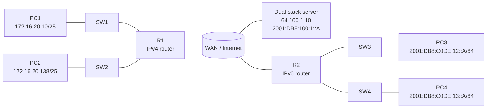
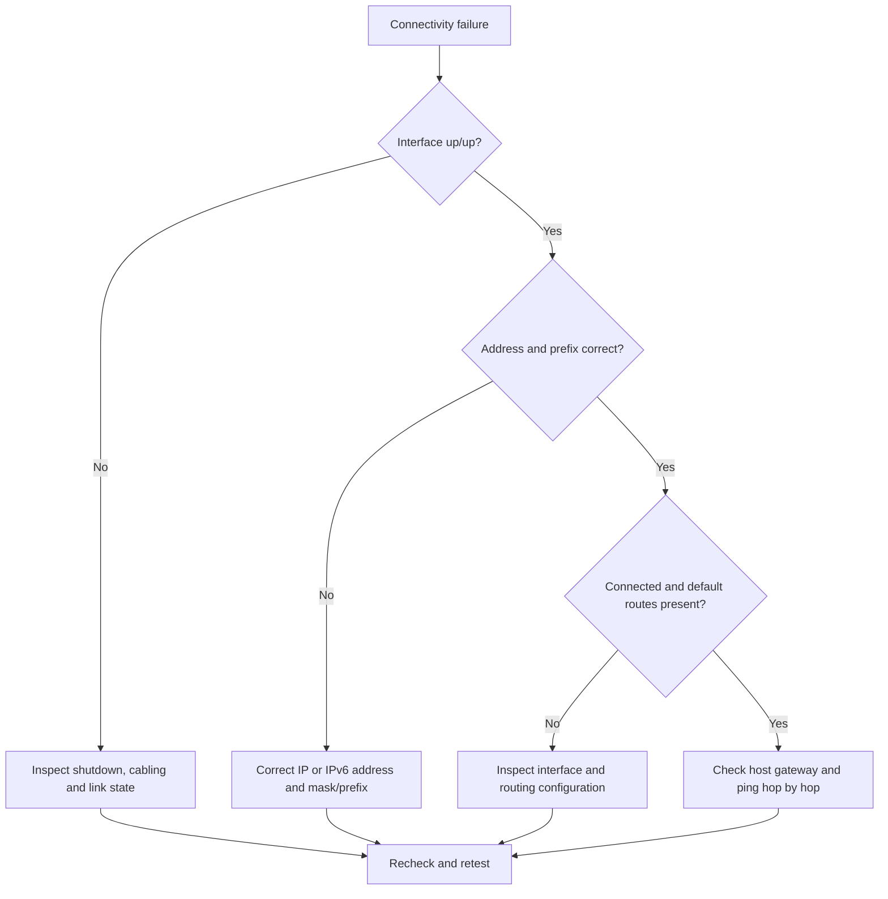
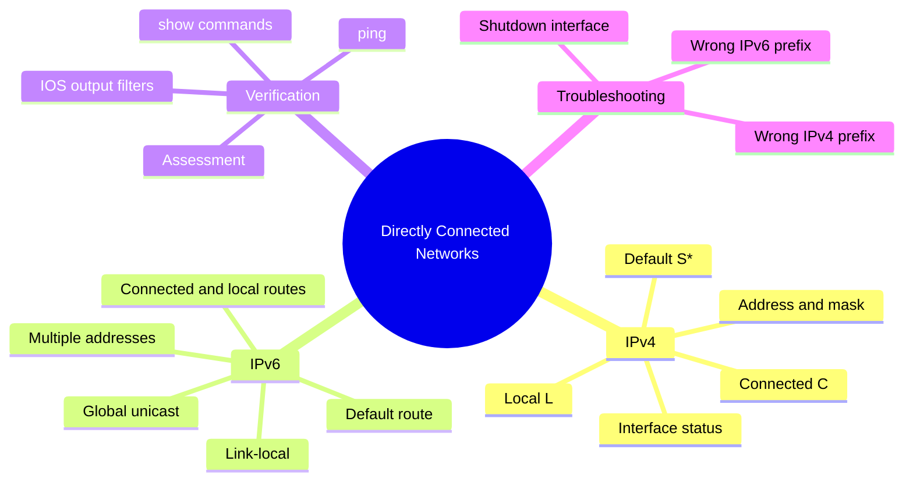

# Lab 1.5.10 — Packet Tracer: Verify Directly Connected Networks

**Course:** CCNAv7 — Switching, Routing, and Wireless Essentials (SRWE)  
**Module:** 1 — Basic Device Configuration  
**Result:** Completed — **100%**, as confirmed by the learner  
**Scope:** IPv4 and IPv6 directly connected networks, routing-table inspection, interface troubleshooting, and end-to-end reachability.

## Objective

- Inspect IPv4 and IPv6 interface state and addressing on R1 and R2.
- Identify directly connected (`C`), local (`L`), and default (`S`/`S*`) routes.
- Apply targeted corrections to deliberately misconfigured interfaces.
- Verify connectivity between local networks and a dual-stack server.
- Practice Cisco IOS output filters (`include`, `exclude`, and `begin`).

## Environment and Topology

The topology includes R1, R2, four LAN hosts (PC1–PC4), access switches, an intervening WAN/Internet segment, and a dual-stack server. The two routers serve separate IPv4 and IPv6 LANs.



> Diagram is a logical representation, not an exported Packet Tracer topology. The intermediate WAN configuration was not modified in this exercise.

## Addressing Table

| Device | Interface | IPv4 / IPv6 | Gateway |
|---|---|---|---|
| R1 | G0/0/0 | 172.16.20.1/25 | N/A |
| R1 | G0/0/1 | 172.16.20.129/25 | N/A |
| R1 | S0/1/0 | 209.165.200.225/30 | N/A |
| PC1 | NIC | 172.16.20.10/25 | 172.16.20.1 |
| PC2 | NIC | 172.16.20.138/25 | 172.16.20.129 |
| R2 | G0/0/0 | 2001:DB8:C0DE:12::1/64 | N/A |
| R2 | G0/0/1 | 2001:DB8:C0DE:13::1/64 | N/A |
| R2 | S0/1/1 | 2001:DB8:C0DE:11::1/64 | N/A |
| PC3 | NIC | 2001:DB8:C0DE:12::A/64 | FE80::2 |
| PC4 | NIC | 2001:DB8:C0DE:13::A/64 | FE80::2 |
| Dual-stack server | NIC | 64.100.1.10; 2001:DB8:100:1::A | Preconfigured |

R2 G0/0/0 and G0/0/1 use `FE80::2` as their link-local address. The observed link-local address on R2 S0/1/1 was `FE80::2D0:BCFF:FE32:7C24`; the lab's WAN serial interface was left unchanged.

## Prerequisites

- Cisco Packet Tracer and the provided activity file.
- Access to R1 and R2 privileged EXEC mode.
- Existing WAN and host configuration provided by the activity.
- All configuration commands below are scoped to the lab, not production deployment.

## Configuration Procedure

### Part 1 — IPv4: R1 diagnosis and correction

Initial observation:

| Interface | Initial configuration | Initial state | Fault |
|---|---|---|---|
| G0/0/0 | 172.16.20.1/25 | administratively down/down | `shutdown` enabled |
| G0/0/1 | 172.16.20.129/25 | up/up | None |
| S0/1/0 | 209.165.200.229/29 | up/up | Wrong address and mask |

Inspection:

```cisco
show ip interface brief | exclude unassigned
show running-config | section interface
```

Targeted repair (also available in [`configs/r1-fix.cli`](configs/r1-fix.cli)):

```cisco
configure terminal
interface GigabitEthernet0/0/0
 no shutdown
 exit
interface Serial0/1/0
 no ip address
 ip address 209.165.200.225 255.255.255.252
 exit
end
```

The serial interface's existing `clock rate 2000000` and circuit description were preserved.

### Part 2 — IPv6: R2 diagnosis and correction

Initial observation: G0/0/1 was operational but had the **wrong global unicast address** `2001:DB8:C0DE:14::1/64`. The correct prefix was `2001:DB8:C0DE:13::/64`.

Inspection:

```cisco
show ipv6 interface brief
show running-config | section interface
```

Targeted repair (also available in [`configs/r2-fix.cli`](configs/r2-fix.cli)):

```cisco
configure terminal
interface GigabitEthernet0/0/1
 no ipv6 address 2001:DB8:C0DE:14::1/64
 ipv6 address 2001:DB8:C0DE:13::1/64
end
```

An IPv6 interface can have multiple global addresses; explicitly remove the incorrect address rather than merely adding another. Preserve the existing `FE80::2` link-local address.

## Verification and Observed Results

### IPv4 interface state and route table

After repair, R1 reported all three relevant interfaces `up/up`:

| Interface | Observed address | State |
|---|---|---|
| G0/0/0 | 172.16.20.1 | up/up |
| G0/0/1 | 172.16.20.129 | up/up |
| S0/1/0 | 209.165.200.225 | up/up |

```cisco
show ip route | begin Gate
show interfaces | include Desc|conn
show interfaces GigabitEthernet0/0/0 | include Duplex|duplex
```

**Lab question answers, observed:**

| Question | Answer |
|---|---|
| Gateway of last resort | `209.165.200.226` |
| Serial circuit ID | `BCB123450001` |
| G0/0/0 duplex | Full Duplex |
| G0/0/0 speed | 100 Mbps |
| G0/0/0 media | RJ45 |

Observed IPv4 route categories:

| Code | Prefix | Next hop / interface |
|---|---|---|
| C | 172.16.20.0/25 | G0/0/0 |
| L | 172.16.20.1/32 | G0/0/0 |
| C | 172.16.20.128/25 | G0/0/1 |
| L | 172.16.20.129/32 | G0/0/1 |
| C | 209.165.200.224/30 | S0/1/0 |
| L | 209.165.200.225/32 | S0/1/0 |
| S* | 0.0.0.0/0 | via 209.165.200.226 |

### IPv6 interface state and route table

```cisco
show ipv6 interface brief
show ipv6 route
show running-config | include ipv6|interface
```

The R2 route table displayed **8 entries**, including the default route `S ::/0` through Serial0/1/1; connected/local routes for the `11::/64`, `12::/64`, and `13::/64` networks; and the local multicast route `FF00::/8` to Null0.

| Code | Prefix | Interface |
|---|---|---|
| S | ::/0 | Serial0/1/1 |
| C | 2001:DB8:C0DE:11::/64 | Serial0/1/1 |
| L | 2001:DB8:C0DE:11::1/128 | Serial0/1/1 |
| C | 2001:DB8:C0DE:12::/64 | G0/0/0 |
| L | 2001:DB8:C0DE:12::1/128 | G0/0/0 |
| C | 2001:DB8:C0DE:13::/64 | G0/0/1 |
| L | 2001:DB8:C0DE:13::1/128 | G0/0/1 |
| L | FF00::/8 | Null0 |

**Lab question answers, observed:** all configured R2 network interfaces were `up/up` (G0/0/0, G0/0/1, S0/1/1). Each GigabitEthernet interface had **two configured IPv6 addresses**: one link-local and one global unicast.

### Connectivity tests

Results below were transcribed from the learner's actual Packet Tracer screenshots, not simulated or inferred.

| Source | Destination | Replies | Loss | Outcome |
|---|---|---|---|---|
| PC1 | PC2 — 172.16.20.138 | 3/4 | 25% | Reachable |
| PC1 | Server — 64.100.1.10 | 3/4 | 25% | Reachable |
| PC2 | PC1 — 172.16.20.10 | 4/4 | 0% | Reachable |
| PC2 | Server — 64.100.1.10 | 4/4 | 0% | Reachable |
| PC3 | PC4 — 2001:DB8:C0DE:13::A | 4/4 | 0% | Reachable |
| PC3 | Server — 2001:DB8:100:1::A | 4/4 | 0% | Reachable |
| PC4 | PC3 — 2001:DB8:C0DE:12::A | 4/4 | 0% | Reachable |
| PC4 | Server — 2001:DB8:100:1::A | 4/4 | 0% | Reachable |

The first IPv4 echo request from PC1 timed out in two tests. Initial Address Resolution Protocol (ARP) resolution is a plausible cause, but the captures alone do not prove it. Subsequent replies confirmed reachability; no sustained IPv4 packet loss was demonstrated.

**Packet Tracer assessment:** **100%**, explicitly confirmed by the learner after the final tests. This percentage is the activity assessment result, not a measurement of network performance.

## Troubleshooting

| Symptom | Root cause observed | Correction | Verification |
|---|---|---|---|
| PC1-facing R1 interface disabled | `shutdown` on G0/0/0 | `no shutdown` | `show ip interface brief` showed up/up |
| Wrong R1 WAN network | S0/1/0 configured as 209.165.200.229/29 | Change to 209.165.200.225/30 | Connected route 209.165.200.224/30 |
| Incorrect IPv6 LAN prefix on R2 | G0/0/1 had 2001:DB8:C0DE:14::1/64 | Remove wrong IPv6 and add 13::1/64 | IPv6 route 13::/64 appeared; end-to-end pings succeeded |

### Diagnostic decision flow



## Mind Map



## Security and Automation Notes

**Production access:** prefer SSHv2 with individual accounts, AAA where available, restricted management-plane access, and key-based authentication when supported. Telnet transmits credentials and traffic in cleartext and should not be used for production management. These SSH controls were **not configured or tested in this activity**.

**Automation opportunities:** collect `show ip interface brief`, `show ipv6 interface brief`, `show ip route`, and `show ipv6 route` through SSH using Ansible or a Python SSH library; compare results against an addressing source of truth; flag administratively down interfaces, unexpected prefixes, and missing routes; optionally apply approved changes. Automation should be validated in a lab and should not blindly enable interfaces or overwrite WAN addresses.

A minimal *illustrative* Ansible verification task for supported IOS devices (requires inventory, SSH connectivity, and `cisco.ios` collection):

```yaml
- name: Audit directly connected networks
  hosts: routers
  gather_facts: false
  tasks:
    - name: Collect interface and routing state
      cisco.ios.ios_command:
        commands:
          - show ip interface brief
          - show ip route
          - show ipv6 interface brief
          - show ipv6 route
      register: network_state
    - name: Display collected outputs
      ansible.builtin.debug:
        var: network_state.stdout
```

This is an example for real IOS/compatible emulators; Packet Tracer does not necessarily expose the same automation integration.

## Evidence / Screenshots

The learner supplied console and ping screenshots during the guided session. The observed values and pass/fail counts are transcribed in this README. The original screenshots for this particular lab were **not available as separately identifiable files in the export workspace**, so this package does not falsely attach images from other labs. If the originals are exported later, place them under `screenshots/` and link them here in chronological order:

1. R1 initial interface state and running configuration.
2. R1 corrected interfaces, routing table, Circuit ID and duplex.
3. PC1 and PC2 IPv4 ping results.
4. R2 initial IPv6 state and wrong prefix.
5. R2 corrected IPv6 routes and configuration.
6. PC3 and PC4 IPv6 ping results.
7. Packet Tracer assessment (100%), if captured.

## Cleanup / Reset

The activity is complete. To preserve the final state, save the Packet Tracer project locally. The README documents the specific changes without requiring the original `.pkt` file to be distributed. The lab did not demonstrate a router `copy running-config startup-config` operation; do not assume one was performed.

## Lessons Learned

- Interface `up/up` does not guarantee that the configured network prefix is correct.
- A shutdown interface prevents the associated connected route from becoming active.
- IPv4 `C` routes represent connected subnets; `L` routes identify the router's interface addresses.
- IPv6 interfaces can have both global and link-local addresses and can support multiple global prefixes.
- Filtered IOS output helps isolate operational details without losing the ability to inspect full configuration.
- Verify connectivity from both LANs and to remote networks, not only to the local gateway.

## References

- Cisco Networking Academy — CCNAv7 SRWE, Packet Tracer activity 1.5.10 (learner-provided instructions and outputs).
- Cisco IOS command-line reference (`show ip route`, `show ipv6 route`, `show interfaces`, and output modifiers).

*Educational lab notes; no real credentials or production device details are included.*
