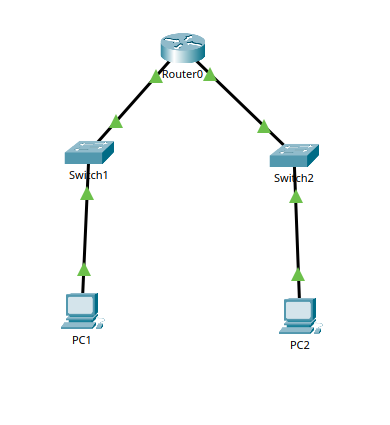
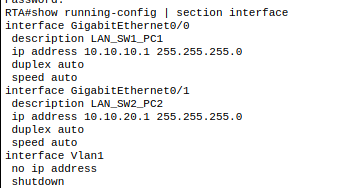
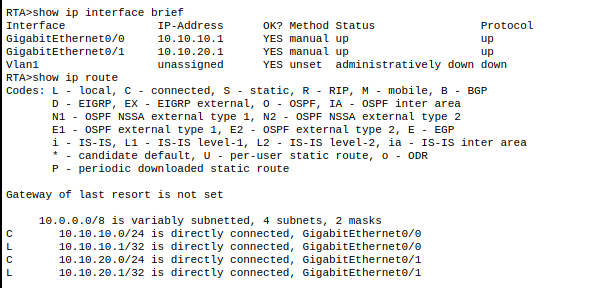
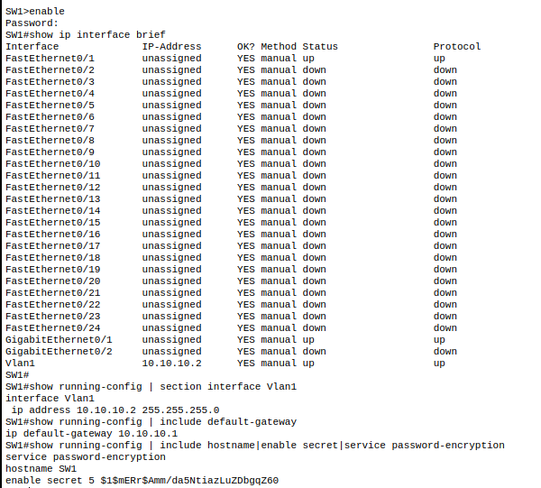
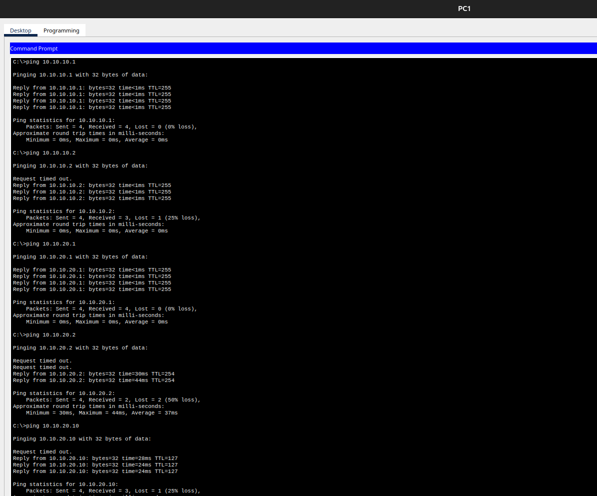
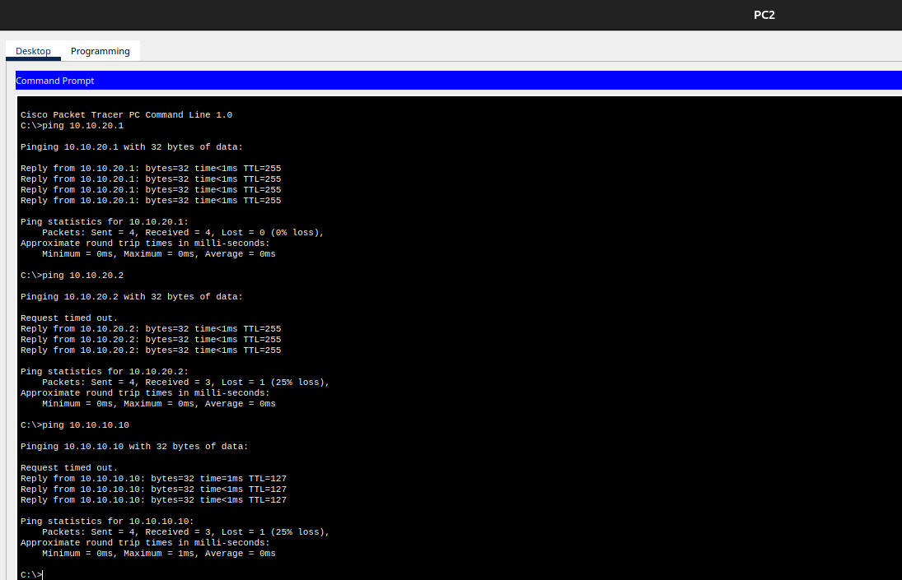
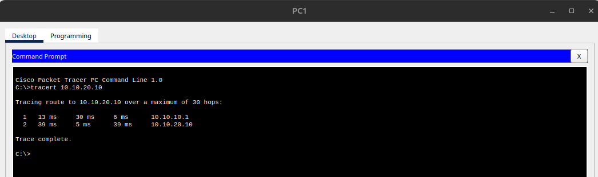
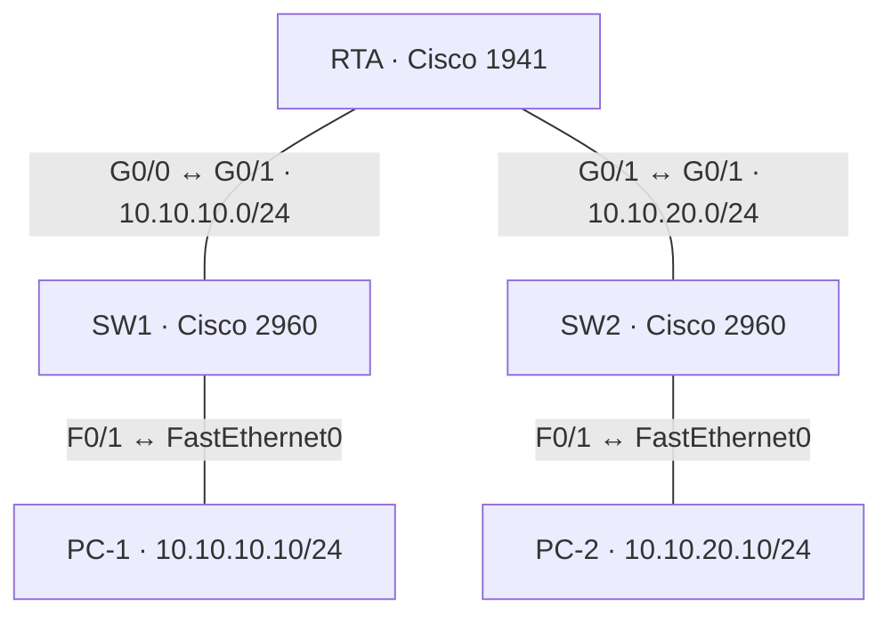
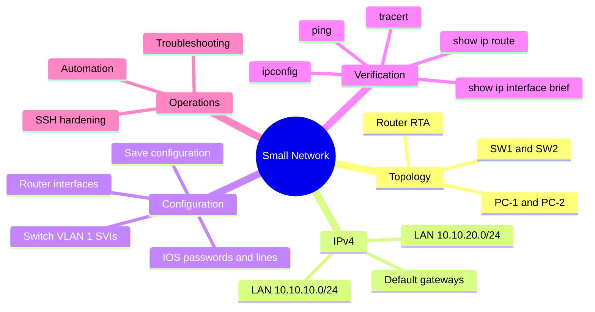

# Lab 1.6.1 — Packet Tracer: Implement a Small Network

**Course:** CCNAv7 — Switching, Routing, and Wireless Essentials (SRWE)  
**Environment:** Cisco Packet Tracer; Cisco 1941 router, two Cisco 2960 switches, two PCs

## Evidence and Deliverables


### Evidence 01 — Packet Tracer topology



The image shows the five devices and their physical connections. The visible display labels are Packet Tracer defaults; grading may require exact display names.

### Evidence 02 — RTA interface configuration



The capture shows `GigabitEthernet0/0` configured as `10.10.10.1/24` (`LAN_SW1_PC1`) and `GigabitEthernet0/1` as `10.10.20.1/24` (`LAN_SW2_PC2`). See [`configs/rta.cli`](configs/rta.cli) for a reproducible configuration.

### Evidence 03 — RTA interfaces and routing table



Both Gigabit interfaces are `up/up`; routes `10.10.10.0/24` and `10.10.20.0/24` are directly connected. No default route is needed between these LANs.

### Evidence 04 — SW1 management configuration



VLAN 1 is `10.10.10.2/24` (`up/up`), with gateway `10.10.10.1`. The screenshot also verifies hostname and password configuration indicators.

### Evidence 05 — SW2 management configuration


VLAN 1 is `10.10.20.2/24` (`up/up`), with gateway `10.10.20.1`.

### Evidence 06 — PC1 connectivity tests



| Destination | Responses | Packet loss |
|---|---:|---:|
| `10.10.10.1` (RTA) | 4/4 | 0% |
| `10.10.10.2` (SW1) | 3/4 | 25% |
| `10.10.20.1` (RTA) | 4/4 | 0% |
| `10.10.20.2` (SW2) | 2/4 | 50% |
| `10.10.20.10` (PC2) | 3/4 | 25% |

All targets responded, including the remote LAN. Early losses may be consistent with ARP resolution, but their cause is not established by the screenshot.

### Evidence 07 — PC2 connectivity tests



| Destination | Responses | Packet loss |
|---|---:|---:|
| `10.10.20.1` (RTA) | 4/4 | 0% |
| `10.10.20.2` (SW2) | 3/4 | 25% |
| `10.10.10.10` (PC1) | 3/4 | 25% |

The remote PC1 responded successfully.

### Evidence 08 — PC1 traceroute to PC2



`tracert 10.10.20.10` completed in two hops: `10.10.10.1` (RTA) and `10.10.20.10` (PC2), confirming the expected Layer 3 path.

## Included Configuration Artifacts

| File | Purpose |
|---|---|
| [`configs/rta.cli`](configs/rta.cli) | Router hostname, security lines, IPv4 interfaces |
| [`configs/sw1.cli`](configs/sw1.cli) | SW1 VLAN 1 management, gateway, access lines |
| [`configs/sw2.cli`](configs/sw2.cli) | SW2 VLAN 1 management, gateway, access lines |
| [`configs/PC-1.txt`](configs/PC-1.txt) | PC-1 static IPv4 settings and verification |
| [`configs/PC-2.txt`](configs/PC-2.txt) | PC-2 static IPv4 settings and verification |

## Objective

Build a small routed network with two IPv4 LANs, configure router and switch management, set host addressing, and verify local and inter-LAN connectivity.

## Environment and Topology



All four links use copper straight-through cabling. The source topology screenshot showed Packet Tracer's default display names (`Router0`, `Switch1`, `Switch2`, `PC1`, `PC2`); the lab requires display labels `RTA`, `SW1`, `SW2`, `PC-1`, and `PC-2` for assessment matching. Device IOS hostnames and Packet Tracer display names are distinct properties.

## Addressing Table

| Device | Interface | IPv4 address | Mask | Default gateway |
|---|---|---|---|---|
| RTA | G0/0 | 10.10.10.1 | 255.255.255.0 | N/A |
| RTA | G0/1 | 10.10.20.1 | 255.255.255.0 | N/A |
| SW1 | VLAN 1 | 10.10.10.2 | 255.255.255.0 | 10.10.10.1 |
| SW2 | VLAN 1 | 10.10.20.2 | 255.255.255.0 | 10.10.20.1 |
| PC-1 | FastEthernet0 | 10.10.10.10 | 255.255.255.0 | 10.10.10.1 |
| PC-2 | FastEthernet0 | 10.10.20.10 | 255.255.255.0 | 10.10.20.1 |

## Prerequisites

- Add one Cisco 1941, two Cisco 2960 switches, and two PCs.
- Connect the exact ports shown in the diagram.
- Use the **Desktop → IP Configuration** panel on each PC.
- Configure the Packet Tracer display names separately from the IOS hostnames.

## Configuration Procedure

The `.cli` files are command scripts, not exported device configurations. Enter privileged EXEC with `enable` before pasting them. Confirm the destination filename when `copy running-config startup-config` prompts for it.

The scripts below reconstruct the lab's requested configuration. The supplied screenshots directly confirm the interface addresses, descriptions, management SVIs, default gateways, and the switches’ hashed enable secrets. A hash alone does not confirm that the original password matches the exercise. They do **not** independently show every line-password or banner command; those commands are included as reproducible lab instructions, not claimed as observed CLI output.

### RTA — Router configuration

```cisco
configure terminal
hostname RTA
service password-encryption
enable secret Ciscoenpa55
banner motd #Unauthorized access is prohibited.#
line console 0
 password Ciscolinepa55
 login
 logging synchronous
exit
line aux 0
 password Ciscolinepa55
 login
exit
line vty 0 4
 transport input all
 password Ciscolinepa55
 login
exit
interface GigabitEthernet0/0
 description LAN_SW1_PC1
 ip address 10.10.10.1 255.255.255.0
 no shutdown
exit
interface GigabitEthernet0/1
 description LAN_SW2_PC2
 ip address 10.10.20.1 255.255.255.0
 no shutdown
exit
end
copy running-config startup-config
```

The exercise uses `Ciscoenpa55` for `enable secret` and `Ciscolinepa55` for console, AUX (RTA), and VTY lines. These are the supplied lab credentials. `login` enables line-password authentication; `transport input all` explicitly permits supported inbound VTY protocols. This reconstruction uses VTY 0–4 on the 1941 and VTY 0–15 on the 2960 switches; inspect `show line` on the selected devices to confirm the available lines. Telnet can be used for this basic lab; SSH would require additional configuration.

### SW1 — Management configuration

```cisco
configure terminal
hostname SW1
service password-encryption
enable secret Ciscoenpa55
interface Vlan1
 ip address 10.10.10.2 255.255.255.0
 no shutdown
exit
ip default-gateway 10.10.10.1
line console 0
 password Ciscolinepa55
 login
exit
line vty 0 15
 transport input all
 password Ciscolinepa55
 login
exit
end
copy running-config startup-config
```

### SW2 — Management configuration

```cisco
configure terminal
hostname SW2
service password-encryption
enable secret Ciscoenpa55
interface Vlan1
 ip address 10.10.20.2 255.255.255.0
 no shutdown
exit
ip default-gateway 10.10.20.1
line console 0
 password Ciscolinepa55
 login
exit
line vty 0 15
 transport input all
 password Ciscolinepa55
 login
exit
end
copy running-config startup-config
```

### PC addressing

Configure the IP, subnet mask, and gateway from the addressing table on each PC through **Desktop → IP Configuration**. Use `ipconfig /all` in the PC command prompt to verify.

## Verification and Observed Results

### Router interfaces and routes

Commands used:

```cisco
show running-config | section interface
show ip interface brief
show ip route
```

Observed on RTA:

| Interface | IP | Status | Protocol |
|---|---|---|---|
| GigabitEthernet0/0 | 10.10.10.1 | up | up |
| GigabitEthernet0/1 | 10.10.20.1 | up | up |
| VLAN 1 | unassigned | administratively down | down |

The routing table showed directly connected (`C`) networks `10.10.10.0/24` and `10.10.20.0/24`, with corresponding local (`L`) /32 routes. No gateway of last resort was set; none is required for traffic between these two directly connected LANs.

### Switch management

Commands used:

```cisco
show ip interface brief
show running-config | section interface Vlan1
show running-config | include default-gateway
show running-config | include hostname|enable secret|service password-encryption
```

Observed: SW1 VLAN 1 `10.10.10.2/24`, `up/up`, gateway `10.10.10.1`; SW2 VLAN 1 `10.10.20.2/24`, `up/up`, gateway `10.10.20.1`. Both switch captures showed `service password-encryption` and a hashed `enable secret`.

### Host configuration

The intended settings are PC-1 `10.10.10.10/24`, gateway `10.10.10.1`, and PC-2 `10.10.20.10/24`, gateway `10.10.20.1`. The PC addresses match the ping targets in the supplied captures. No `ipconfig /all` capture is included, so host masks and gateways are documented settings rather than directly observed output. Use the PC configuration files to apply and verify them.

### ICMP connectivity

| Source | Destination | Observed replies | Result |
|---|---|---|---|
| PC-1 | RTA G0/0 · 10.10.10.1 | 4/4 | Reachable |
| PC-1 | SW1 · 10.10.10.2 | 3/4 | Reachable |
| PC-1 | RTA G0/1 · 10.10.20.1 | 4/4 | Reachable |
| PC-1 | SW2 · 10.10.20.2 | 2/4 | Reachable; initial losses |
| PC-1 | PC-2 · 10.10.20.10 | 3/4 | Reachable |
| PC-2 | RTA G0/1 · 10.10.20.1 | 4/4 | Reachable |
| PC-2 | SW2 · 10.10.20.2 | 3/4 | Reachable |
| PC-2 | PC-1 · 10.10.10.10 | 3/4 | Reachable |

Some first attempts timed out, plausibly while ARP resolution completed. The screenshots show subsequent successful replies; they do not prove the precise cause of the timeouts.

### Inter-LAN path

The observed `tracert 10.10.20.10` from PC-1 completed in two hops:

```text
1  10.10.10.1   (RTA)
2  10.10.20.10  (PC-2)
```

This verifies Layer 3 forwarding through the router between the two subnets.

### Assessment

**Reported final assessment: 100% (unverified).** This result was recorded in the existing documentation, but no assessment capture or Packet Tracer activity file (`.pkt`/`.pka`) is included. The topology capture still shows default display names, and the CLI captures do not prove all line passwords, the router banner, or saved startup configurations. Rename the devices to `RTA`, `SW1`, `SW2`, `PC-1`, and `PC-2` in Packet Tracer and inspect Assessment Items to verify the final result. IOS hostname commands do not change these display labels.

### Remaining verification in Packet Tracer

- Apply the scripts to the appropriate devices and configure both PCs from the addressing table.
- Check `show line`, `show running-config`, and `show startup-config` for the required lines, passwords, banner, interfaces, and saved configuration.
- From both PCs, ping all other device addresses, repeat tests with losses, and verify the inter-LAN path with `tracert`.
- Test remote switch management from the opposite LAN, for example `telnet 10.10.20.2` from PC-1 and `telnet 10.10.10.2` from PC-2; authenticate using the lab line password.
- Record the final display labels and assessment. These checks have not been rerun as part of this folder review.

## Troubleshooting

| Symptom | Checks | Corrective action |
|---|---|---|
| Interface down/down | Cable, switch port, device power | Verify physical connections |
| Interface administratively down | `show ip interface brief` | Apply `no shutdown` |
| Cannot reach remote LAN | PC gateway and router interfaces | Correct host gateway and interface IPs |
| Switch SVI unreachable | `show ip interface brief`, VLAN and active access ports | Verify VLAN 1 has an active member port and SVI is enabled |
| Switch cannot reach remote subnet | `show running-config | include default-gateway` | Set the switch's local router IP as default gateway |
| Initial ICMP timeout | Repeat ping; check ARP state | Allow neighbor resolution and retest |
| Connectivity works but assessment is low | Assessment Items and display labels | Match exact requested display names and inspect rubric |

## Production Security Notes

This lab uses basic password-based management to illustrate Cisco IOS fundamentals. For production, prefer **SSH version 2**, named local users or centralized AAA, strong secrets, and restricted management access. Avoid Telnet because it transmits session data without encryption. `service password-encryption` provides only reversible obfuscation for many legacy line passwords and is **not** a substitute for SSH or modern password hashing. Consider a dedicated management VLAN instead of VLAN 1 where the network design permits.

## Automation Opportunity

The same base configuration can be standardized through parameterized templates and delivered with Ansible (`cisco.ios` collections), Python/Netmiko, or infrastructure automation platforms. Inventory data should hold per-device hostnames, interface IPs, and gateways; credentials should be managed in a secret store. Always validate changes with show commands and connectivity tests. Automation is a production extension, **not** an activity performed in the supplied lab evidence.

## Lab Mind Map



## Evidence Coverage

Eight screenshot files are included and embedded in Evidence 01–08 above. There are no separate PC addressing or assessment captures. The original images are preserved as evidence of the captured state; the corrected scripts describe the intended configuration and have not been executed in Packet Tracer during this review.

The exercise's `10.10.20,2` entry is a typographical error; the valid SW2 address is `10.10.20.2`, matching the supplied CLI capture and configurations.

## Cleanup / Reset

The final configurations should remain saved using `copy running-config startup-config`. Preserve the Packet Tracer activity locally; do not distribute proprietary exercise files unless permitted.

## Lessons Learned

- Two IP subnets need a Layer 3 gateway for inter-LAN traffic.
- Layer 2 switch management addresses are configured on SVIs, not ordinary access ports.
- A switch's `ip default-gateway` supports off-subnet management traffic when it operates as a Layer 2 switch.
- Connected routes appear automatically when routed interfaces are correctly addressed and operational.
- Successful pings and traceroutes validate network behavior, while Packet Tracer assessment criteria can additionally require exact display names and configuration details.
- Production management should use SSH and stronger credential practices; repetitive configurations are good candidates for automation.

## References

- Cisco Networking Academy, CCNAv7 SRWE — Packet Tracer Lab 1.6.1, *Implement a Small Network* (exercise instructions supplied by learner).
- Learner-provided Cisco IOS CLI, PC command prompt, and topology screenshots.
- [Cisco: Configure Telnet, Console and AUX Port Passwords](https://www.cisco.com/c/es_mx/support/docs/ios-nx-os-software/ios-software-releases-110/45843-configpasswords.html), for line-password authentication and inbound transport configuration.

> Educational documentation of a simulated lab. The example configuration is not a production security baseline.
