# Lab 1.6.2 — Configure Basic Router Settings (Physical Mode)

## Objective

Configure and verify basic router settings in Cisco Packet Tracer Physical Mode, including IPv4/IPv6 addressing, device access security, SSH management, routing-table inspection, and IPv6 Stateless Address Autoconfiguration (SLAAC).

This report documents the commands and results observed during the lab, rather than hypothetical test results.

## Environment and Topology

- **Platform:** Cisco Packet Tracer, Physical Mode
- **Router:** Cisco ISR4321/K9 (`R1`)
- **Switch:** Cisco 2960 (`S1`)
- **End devices:** `PC-A` and `Server`
- **Router software reported by `show version`:** Cisco IOS XE 03.16.05.S; IOS 15.5(3)S5
- **Configuration file:** [`configs/r1.ini`](configs/r1.ini) (sanitized running configuration)

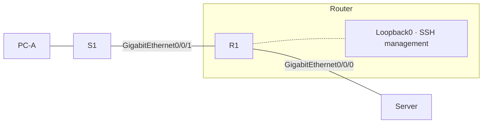

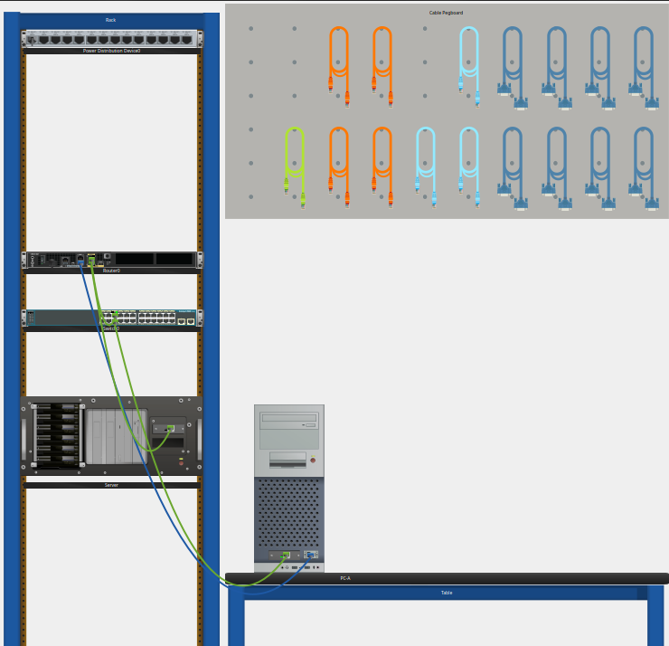

The switch provided Layer 2 connectivity and did not require CLI configuration for this activity.

## Addressing Table

| Device | Interface | IPv4 address / prefix | IPv6 global address / prefix | IPv6 link-local / gateway |
|---|---|---|---|---|
| R1 | GigabitEthernet0/0/0 | `192.168.0.1/24` | `2001:DB8:ACAD::1/64` | `FE80::1` |
| R1 | GigabitEthernet0/0/1 | `192.168.1.1/24` | `2001:DB8:ACAD:1::1/64` | `FE80::1` |
| R1 | Loopback0 | `10.0.0.1/24` | `2001:DB8:ACAD:2::1/64` | `FE80::1` |
| PC-A | Ethernet | `192.168.1.10/24` | `2001:DB8:ACAD:1::10/64` | IPv4 GW: `192.168.1.1`; IPv6 GW: `FE80::1` |
| Server (initial static) | FastEthernet0 | `192.168.0.10/24` | `2001:DB8:ACAD::10/64` | IPv4 GW: `192.168.0.1`; IPv6 GW: `FE80::1` |
| Server (after SLAAC) | FastEthernet0 | `192.168.0.10/24` | `2001:DB8:ACAD:0:207:ECFF:FEA5:6286` | IPv4 GW: `192.168.0.1`; IPv6 GW: `FE80::1` |

The server's automatically generated link-local IPv6 address was `FE80::207:ECFF:FEA5:6286`.

## Configuration Procedure

### 1. End-device addressing

Configure PC-A and the server with the initial static IPv4 and IPv6 addresses shown above using **Desktop → IP Configuration**. Use the router's interface address as the IPv4 default gateway and `FE80::1` as the IPv6 default gateway on each respective link.

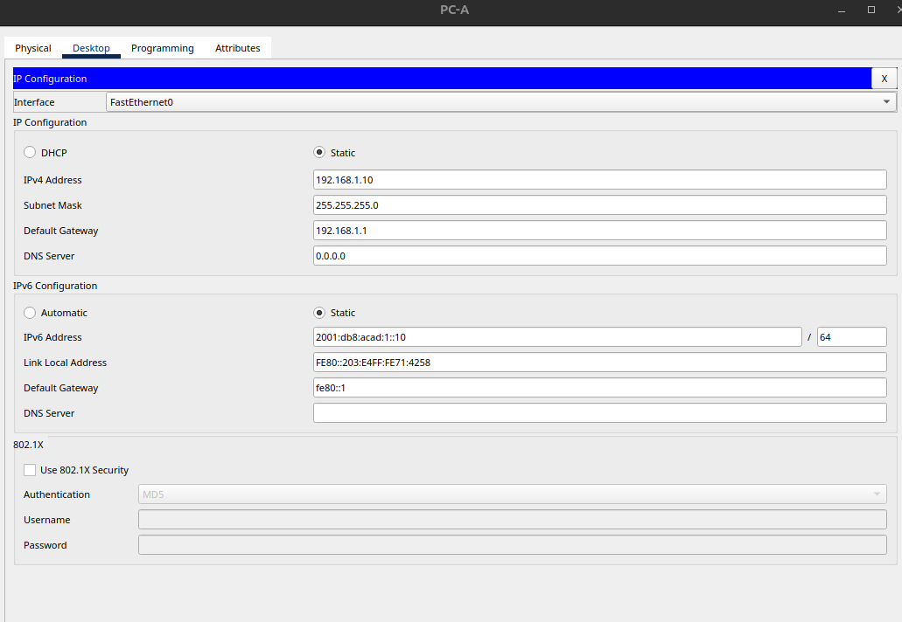

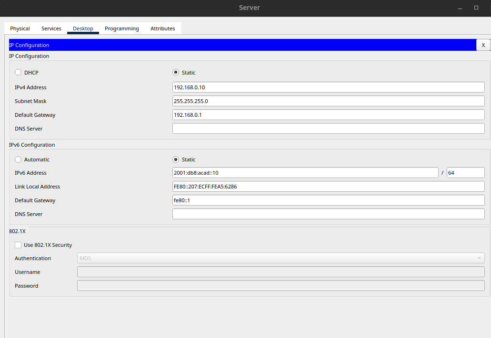

### 2. Basic router configuration and access security

Configure the router hostname and domain, password protection, local SSH user, RSA keys, SSH version 2, console/VTY access restrictions, login blocking, MOTD banner, and IPv6 routing.

Representative commands used in the lab (credentials intentionally omitted):

```cisco
hostname R1
ip domain-name ccna-lab.com
service password-encryption
security passwords min-length 12
ip ssh version 2
ipv6 unicast-routing
login block-for 120 attempts 3 within 60
banner motd #Unauthorized access is prohibited.#
!
line con 0
 exec-timeout 4 0
 login
!
line vty 0 4
 exec-timeout 4 0
 login local
 transport input ssh
```

A local SSH account, privileged-mode secret, console/VTY passwords, and RSA keys were also configured. Passwords and hashes are not reproduced in this public documentation. The verified configuration is available in sanitized form at [`configs/r1.ini`](configs/r1.ini).

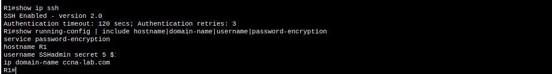

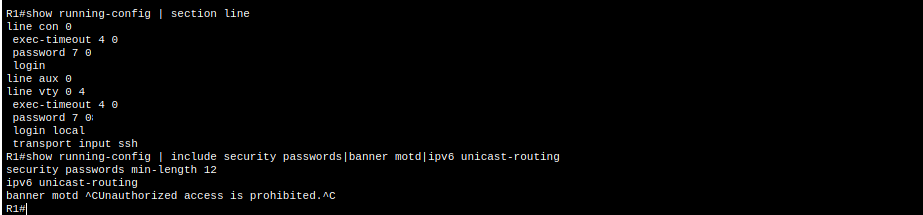

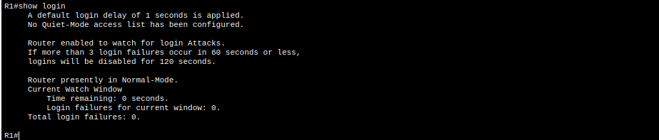

### 3. Router interfaces

Configure `GigabitEthernet0/0/0`, `GigabitEthernet0/0/1`, and `Loopback0` according to the addressing table. Enable the Gigabit Ethernet interfaces with `no shutdown`. The same IPv6 link-local address, `FE80::1`, is valid on these separate links.

Verification commands:

```cisco
show ip interface brief
show ipv6 interface brief
show ip ssh
```

The three configured router interfaces were verified as operational (`up/up`), and SSH reported version 2.0 enabled.

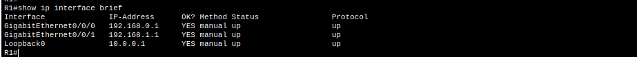

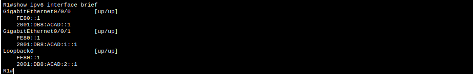

### 4. Configuration persistence and clock

The lab procedure includes setting the clock and saving the active configuration:

```cisco
clock set HH:MM:SS DAY MONTH YEAR
copy running-config startup-config
```

The `show startup-config` output subsequently confirmed a saved configuration. A separate command transcript confirming the clock setting was not provided.

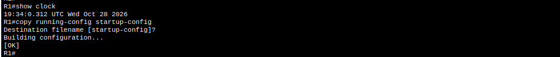

## Verification and Observed Results

### End-to-end connectivity

| Source | Destination | Protocol | Observed result |
|---|---|---|---|
| PC-A | Server `192.168.0.10` | IPv4 ICMP | 3/4 replies; 25% packet loss on initial test |
| PC-A | Server `2001:DB8:ACAD::10` | IPv6 ICMP | 4/4 replies; 0% loss |
| PC-A | R1 Loopback0 `10.0.0.1` | SSH over IPv4 | Successful login; `R1>` prompt displayed |
| PC-A | R1 Loopback0 `2001:DB8:ACAD:2::1` | SSH over IPv6 | Successful login; `R1>` prompt displayed |
| Server (after SLAAC) | R1 `FE80::1` | IPv6 ICMP | 4/4 replies; 0% loss |
| Server (after SLAAC) | R1 `2001:DB8:ACAD::1` | IPv6 ICMP | 4/4 replies; 0% loss |

The initial IPv4 ping had one timeout; subsequent replies confirmed reachability. The initial timeout is consistent with address-resolution activity, although its exact cause was not independently established.

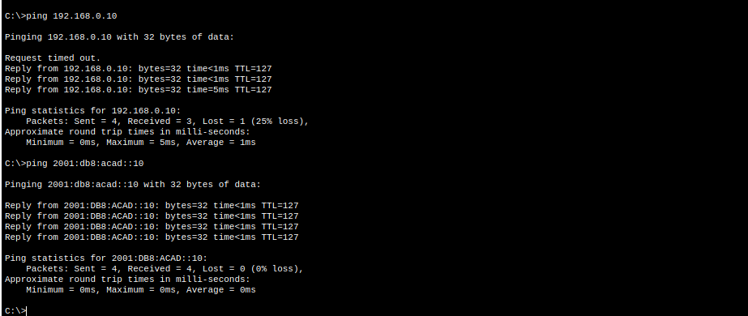

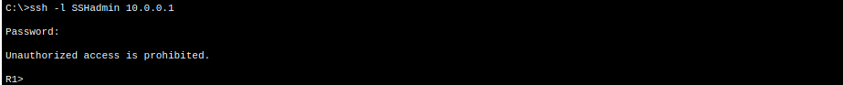

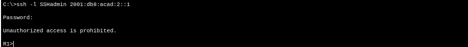

### Router software and boot settings

The `show version` output reported:

| Property | Observed value |
|---|---|
| Router model | Cisco ISR4321/K9 |
| IOS XE | `03.16.05.S` |
| IOS | `15.5(3)S5` |
| System image | `bootflash:/isr4300-universalk9.03.16.05.S.155-3.S5-ext.SPA.bin` |
| Nonvolatile configuration memory | `32768K` (32 MiB) |
| Bootflash memory | `3223551K` (approximately 3.07 GiB) |
| Configuration register | `0x2102` |

The normal configuration register `0x2102` allows the router to load its startup configuration. A hypothetical `0x2142` setting would bypass loading the startup configuration on the next boot without erasing it, a behavior commonly used during password recovery.

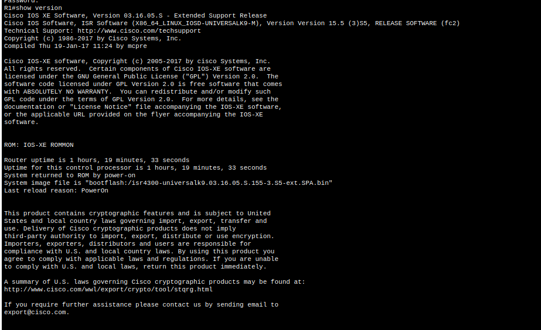


### Saved configuration and VTY security

The observed `show startup-config` contained type 5 hashes for the privileged-mode secret and local SSH account. Console and VTY passwords were represented as type 7 obfuscated values due to `service password-encryption`. Type 7 obfuscation is reversible and is not equivalent to strong password hashing.

The VTY section of `show running-config | section vty` confirmed:

```cisco
line vty 0 4
 exec-timeout 4 0
 password 7 <REDACTED>
 login local
 transport input ssh
```

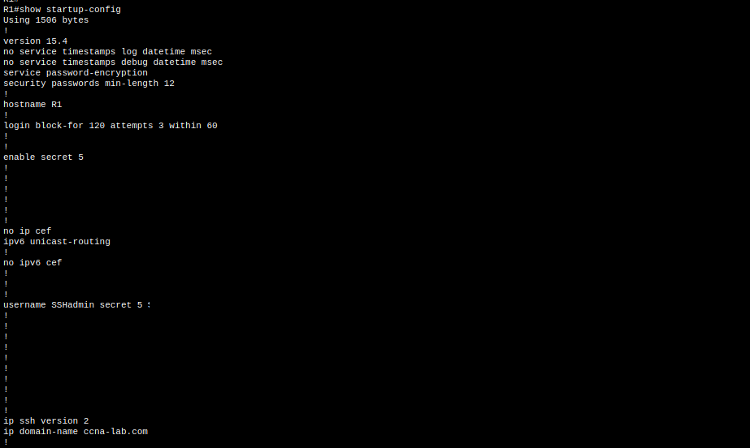

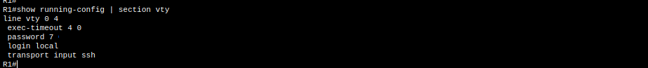

### IPv4 routing table

The `show ip route` output contained **three connected (`C`) routes** and three corresponding local (`L`) host routes:

```text
C  10.0.0.0/24       directly connected, Loopback0
L  10.0.0.1/32       directly connected, Loopback0
C  192.168.0.0/24    directly connected, GigabitEthernet0/0/0
L  192.168.0.1/32    directly connected, GigabitEthernet0/0/0
C  192.168.1.0/24    directly connected, GigabitEthernet0/0/1
L  192.168.1.1/32    directly connected, GigabitEthernet0/0/1
```

No gateway of last resort was configured, which is expected for this directly connected lab topology.

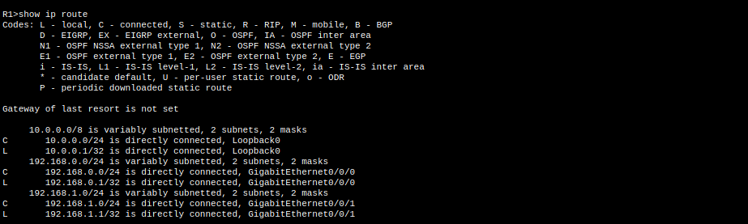

### IPv6 SLAAC on the server

The server's IPv6 setting was changed from **Static** to **Auto Config**. The observed `ipconfig` output then reported:

```text
Link-local IPv6 Address: FE80::207:ECFF:FEA5:6286
IPv6 Address:            2001:DB8:ACAD:0:207:ECFF:FEA5:6286
IPv4 Address:            192.168.0.10
Subnet Mask:             255.255.255.0
Default Gateways:        FE80::1, 192.168.0.1
```

The global IPv6 address belongs to the router-advertised `2001:DB8:ACAD::/64` prefix. Both final gateway pings succeeded with 0% packet loss.

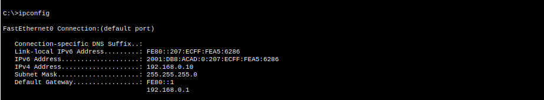

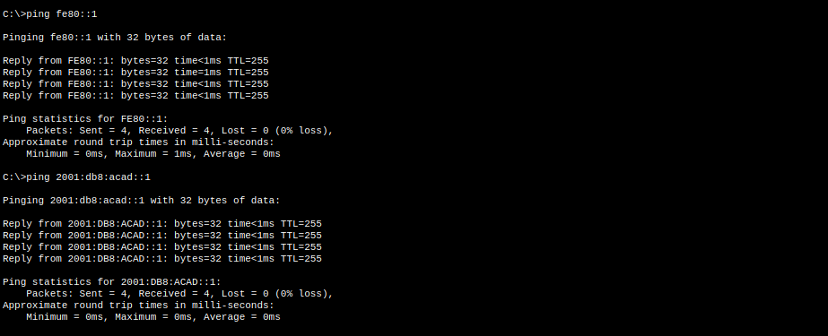

## Troubleshooting and Interpretation

- **Administratively disabled interfaces:** Use `show ip interface brief`; `administratively down` indicates an interface disabled with `shutdown`. Use `no shutdown` in interface configuration mode to enable it.
- **IPv4 subnet mask:** Inspect the `ip address` statement under the interface in `show running-config`, or use `show ip interface` to see the configured prefix.
- **SSH versus Telnet:** SSH encrypts management traffic; Telnet sends credentials and session content in plaintext. The VTY configuration restricts remote access to SSH.
- **ACL interpretation:** The sanitized configuration contains `sl_def_acl`, but the supplied configuration does not show it applied to an interface or VTY line. SSH access control in this lab is demonstrated by `login local` and `transport input ssh`, not by that ACL.
- **Saving configuration:** Unsaved running-configuration changes can be lost on reboot; `copy running-config startup-config` writes the current configuration to NVRAM.

## Evidence Index

The screenshots are displayed inline in the relevant report sections above. This index provides direct links to the original image files in `screenshots/`.

| # | Evidence | File |
|---|---|---|
| 01 | Physical topology | [01-physical-topology.png](screenshots/01-physical-topology.png) |
| 02 | PC-A IP configuration | [02-pc-a-ip-configuration.png](screenshots/02-pc-a-ip-configuration.png) |
| 03 | Server initial IP configuration | [03-server-ip-configuration.png](screenshots/03-server-ip-configuration.png) |
| 04 | R1 basic security and SSH | [04-r1-basic-security-ssh.png](screenshots/04-r1-basic-security-ssh.png) |
| 05 | Console and VTY security | [05-r1-console-vty-security.png](screenshots/05-r1-console-vty-security.png) |
| 06 | IPv4 interface status | [06-r1-ipv4-interface-status.png](screenshots/06-r1-ipv4-interface-status.png) |
| 07 | IPv6 interface status | [07-r1-ipv6-interface-status.png](screenshots/07-r1-ipv6-interface-status.png) |
| 08 | Login security | [08-r1-login-security.png](screenshots/08-r1-login-security.png) |
| 09 | Clock and configuration save | [09-r1-clock-config-save.png](screenshots/09-r1-clock-config-save.png) |
| 10 | IPv4/IPv6 ping tests | [10-pc-a-server-ipv4-ipv6-ping.png](screenshots/10-pc-a-server-ipv4-ipv6-ping.png) |
| 11 | SSH to loopback over IPv4 | [11-pc-a-ssh-ipv4-loopback.png](screenshots/11-pc-a-ssh-ipv4-loopback.png) |
| 12 | SSH to loopback over IPv6 | [12-pc-a-ssh-ipv6-loopback.png](screenshots/12-pc-a-ssh-ipv6-loopback.png) |
| 13 | IOS version, image, and memory | [13-r1-show-version.png](screenshots/13-r1-show-version.png) |
| 14 | Configuration register | [14-r1-configuration-register.png](screenshots/14-r1-configuration-register.png) |
| 15 | Startup configuration password storage | [15-r1-startup-config-passwords.png](screenshots/15-r1-startup-config-passwords.png) |
| 16 | VTY configuration | [16-r1-vty-configuration.png](screenshots/16-r1-vty-configuration.png) |
| 17 | IPv4 routing table | [17-r1-ipv4-routing-table.png](screenshots/17-r1-ipv4-routing-table.png) |
| 18 | Server SLAAC configuration | [18-server-ipv6-autoconfiguration.png](screenshots/18-server-ipv6-autoconfiguration.png) |
| 19 | Final IPv6 gateway pings | [19-server-ipv6-gateway-ping.png](screenshots/19-server-ipv6-gateway-ping.png) |


## Lessons Learned

This lab demonstrated secure router management over IPv4 and IPv6, direct-connected routing, the distinction between global and link-local IPv6 addresses, and the use of SLAAC for host configuration. The verification outputs also illustrated how to inspect startup versus running configuration, interpret connected and local routes, and confirm router boot settings.

## References and Notes

- Cisco Networking Academy — CCNAv7: Switching, Routing, and Wireless Essentials, Packet Tracer Lab 1.6.2, *Configure Basic Router Settings (Physical Mode)*.
- This is an independent lab report based on the observed Packet Tracer activity, not a reproduction of the official lab handout.
- The configuration file is sanitized for publication; redaction placeholders are not valid device credentials and should not be pasted into a live router configuration.
