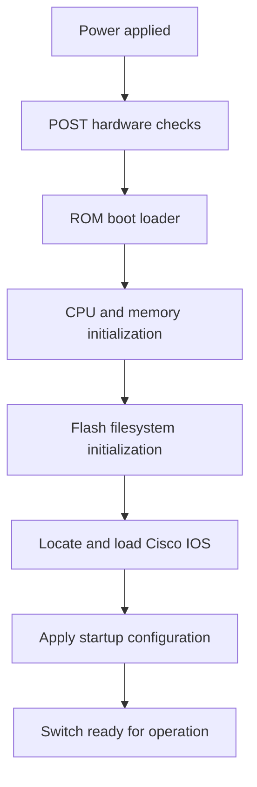
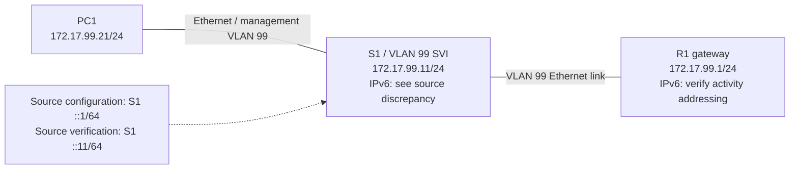
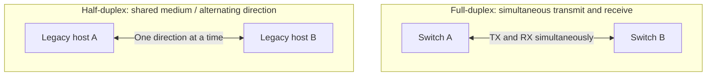
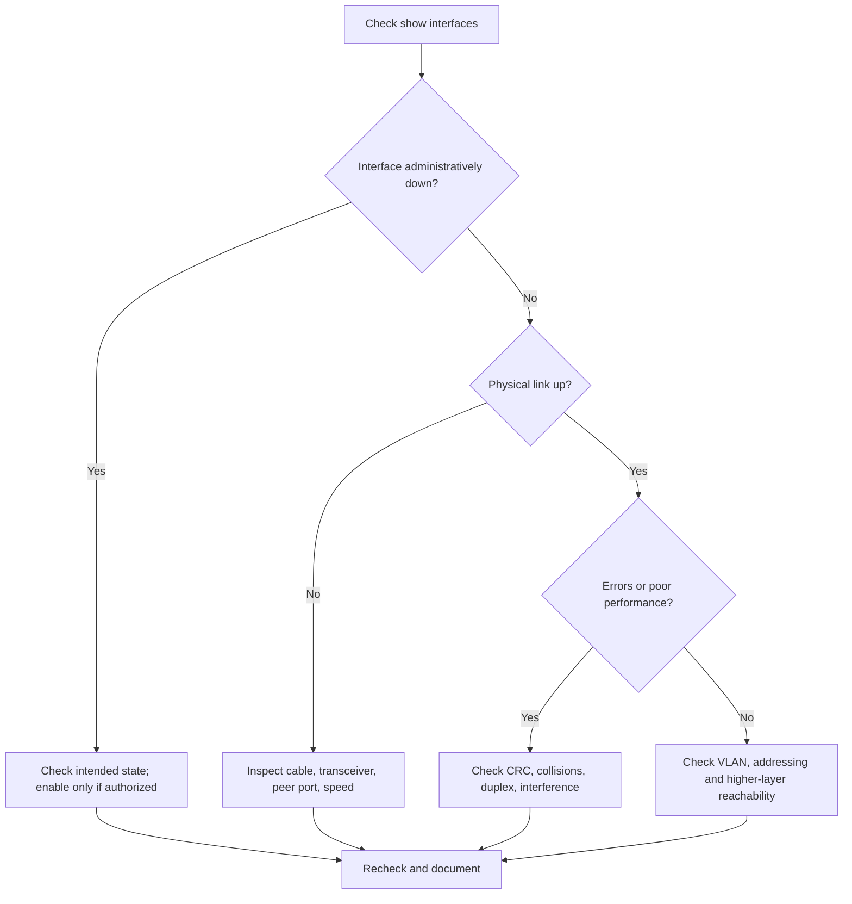
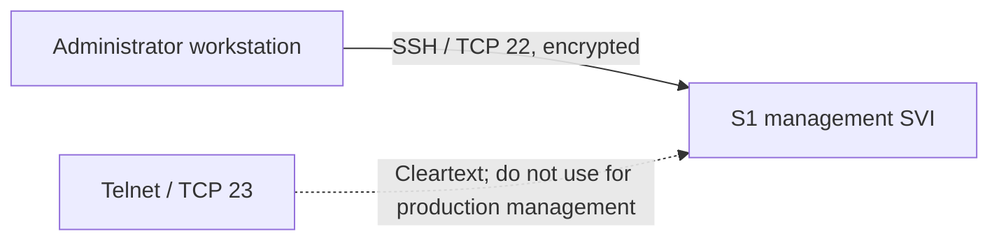
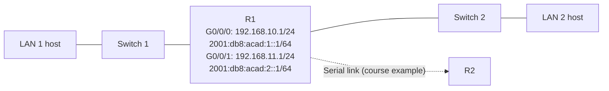
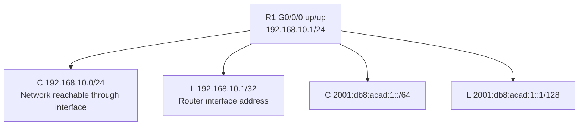
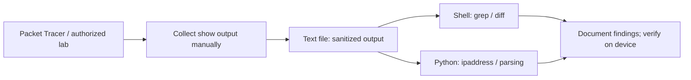
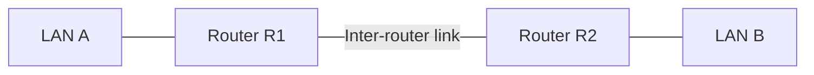

# Module 01 — Basic Device Configuration

> **Course:** CCNAv7 Switching, Routing, and Wireless Essentials (NIC.br)  
> **Status:** Study notes prepared; practical activities and evidence pending.  
> **Source scope:** Sections 1.0–1.6 supplied by the learner. The notes below are original synthesis; professional recommendations and automation examples are supplementary.

> **Diagram policy:** Mermaid figures below are original educational reconstructions based on the supplied course topics, not official Cisco images or evidence of executed labs. Labels and addresses are illustrative unless otherwise noted.

## Table of Contents

- [Module 01 — Basic Device Configuration](#module-01--basic-device-configuration)
  - [Table of Contents](#table-of-contents)
  - [1. Learning Objectives](#1-learning-objectives)
  - [2. Initial Switch Configuration (1.1)](#2-initial-switch-configuration-11)
    - [Boot sequence](#boot-sequence)
    - [Visual reference — switch boot process](#visual-reference--switch-boot-process)
    - [Front-panel indicators](#front-panel-indicators)
    - [Management SVI and gateway](#management-svi-and-gateway)
      - [Step 1 — Configure the management SVI (course command sequence)](#step-1--configure-the-management-svi-course-command-sequence)
      - [Step 2 — Configure the IPv4 default gateway (course command sequence)](#step-2--configure-the-ipv4-default-gateway-course-command-sequence)
      - [Step 3 — Verify the configuration (course commands)](#step-3--verify-the-configuration-course-commands)
      - [Visual reference — management VLAN 99 topology](#visual-reference--management-vlan-99-topology)
  - [3. Switch Port Configuration (1.2)](#3-switch-port-configuration-12)
    - [Duplex and link negotiation](#duplex-and-link-negotiation)
    - [Visual reference — full-duplex versus half-duplex](#visual-reference--full-duplex-versus-half-duplex)
    - [Operational verification](#operational-verification)
    - [Interpreting errors](#interpreting-errors)
    - [Visual reference — diagnosing switch interface faults](#visual-reference--diagnosing-switch-interface-faults)
  - [4. Secure Remote Access (1.3)](#4-secure-remote-access-13)
    - [Visual reference — secure remote administration](#visual-reference--secure-remote-administration)
  - [5. Basic Router Configuration (1.4)](#5-basic-router-configuration-14)
    - [Visual reference — dual-stack directly connected networks](#visual-reference--dual-stack-directly-connected-networks)
  - [6. Verify Directly Connected Networks (1.5)](#6-verify-directly-connected-networks-15)
    - [Visual reference — connected and local routes](#visual-reference--connected-and-local-routes)
    - [Filtering and command history](#filtering-and-command-history)
  - [7. Practical Insights — Shell and Python](#7-practical-insights--shell-and-python)
    - [Visual reference — educational automation workflow](#visual-reference--educational-automation-workflow)
    - [Shell: nonintrusive host-side checks](#shell-nonintrusive-host-side-checks)
    - [Python: verify an IPv4 management addressing plan](#python-verify-an-ipv4-management-addressing-plan)
    - [Further professional extensions](#further-professional-extensions)
  - [8. Common Mistakes and Exam Tips](#8-common-mistakes-and-exam-tips)
  - [9. Practical Activities — Pending](#9-practical-activities--pending)
  - [10. Module Summary and Integration (1.6.3)](#10-module-summary-and-integration-163)
    - [Practice integration — two LANs interconnected by R1 and R2](#practice-integration--two-lans-interconnected-by-r1-and-r2)
    - [Assessment documentation policy](#assessment-documentation-policy)
  - [11. Key Takeaways](#11-key-takeaways)
  - [12. Further Study](#12-further-study)
  - [References](#references)

## 1. Learning Objectives

Configure initial Cisco switch settings, switch ports, secure remote management, router interfaces, and verify connectivity between directly connected networks. Understand both IPv4 and IPv6 management and interface diagnostics.

## 2. Initial Switch Configuration (1.1)

### Boot sequence

A Catalyst switch boots through five stages: (1) ROM-based power-on self-test (POST) checks critical hardware, (2) the ROM boot loader starts, (3) low-level CPU and memory initialization occurs, (4) flash storage is initialized, and (5) the boot loader locates an IOS image, loads it, and transfers control to IOS. IOS then processes the saved startup configuration if available.

The boot image path may be controlled by the `BOOT` environment variable. A platform-specific configuration example from the course is:

```cisco
S1(config)# boot system flash:/c2960-lanbasek9-mz.150-2.SE/c2960-lanbasek9-mz.150-2.SE.bin
S1# show boot
```

Do not copy an image path to another switch without checking its flash contents and software compatibility. The course describes a Catalyst 2960 boot-loader recovery workflow using the console, Mode button, `set`, `flash_init`, `dir flash:`, the `BOOT` variable, and `boot`. Recovery procedures vary by model; changing boot variables or images can render a device unavailable.


### Visual reference — switch boot process



### Front-panel indicators

On the Catalyst 2960 example, `SYST` reports system health; `RPS` reports redundant power supply status; `STAT` changes port LEDs to link/activity status; `DUPLX` indicates duplex mode; `SPEED` indicates link speed; and `PoE`, where available, reports power-delivery state. Interpret colors in the context of the selected LED mode and hardware model. In the learner-provided section 1.6.3 summary, **off** means no power, **steady green** means normal operation, and **steady amber** means powered but malfunctioning. A module review question rejected the statement that blinking amber means POST; do not present that association as an established course answer. The review item itself had an unresolved second-answer ambiguity (see the separate assessment notes).

### Management SVI and gateway

A switch virtual interface (SVI) provides an IP endpoint for remote management of a Layer 2 switch. Configuring an IP address on the management SVI **does not enable inter-VLAN routing**. The course presents three steps: configure the management SVI, configure the IPv4 default gateway, and verify the configuration.

#### Step 1 — Configure the management SVI (course command sequence)

```cisco
S1# configure terminal
S1(config)# interface vlan 99
S1(config-if)# ip address 172.17.99.11 255.255.255.0
S1(config-if)# ipv6 address 2001:db8:acad:99::1/64
S1(config-if)# no shutdown
S1(config-if)# end
S1# copy running-config startup-config
```

**Source fidelity note:** the IPv6 address in the course's configuration command is `2001:db8:acad:99::1/64`, whereas its expected verification output identifies the switch as `2001:DB8:ACAD:99::11`. These values are **not equivalent**. Both are recorded here exactly as supplied; confirm the intended S1 address from the activity's addressing table before applying the configuration. If R1 also uses `2001:db8:acad:99::1/64` on the same link, assigning `::1` to S1 would create an IPv6 address conflict.

#### Step 2 — Configure the IPv4 default gateway (course command sequence)

```cisco
S1# configure terminal
S1(config)# ip default-gateway 172.17.99.1
S1(config)# end
S1# copy running-config startup-config
```

The IPv4 default gateway allows a Layer 2 switch without IP routing enabled to respond to management traffic from other subnets. As described in the course, the switch may learn an IPv6 default router from Router Advertisement (RA) messages rather than configuring an IPv6 gateway with the IPv4 command.

#### Step 3 — Verify the configuration (course commands)

```cisco
S1# show ip interface brief
S1# show ipv6 interface brief
```

The expected IPv4 management address is `172.17.99.11`; the source's **expected** IPv6 display is `2001:DB8:ACAD:99::11` plus a link-local address (`FE80::/10`). These are course expectations, **not observed lab results**. Because the source's IPv6 configuration command uses `::1`, its expected `::11` output cannot follow from that command unchanged.

#### Visual reference — management VLAN 99 topology



| Device | Interface | IPv4 | IPv6 | Purpose |
|---|---|---|---|---|
| S1 | VLAN 99 | `172.17.99.11/24` | `2001:db8:acad:99::1/64` in configuration; `::11/64` in expected verification | Switch management |
| R1 | LAN interface | `172.17.99.1/24` | Confirm with the activity's addressing table | IPv4 management gateway |
| PC1 | NIC | `172.17.99.21/24` | Not specified | Management client |

**Supplementary implementation notes (not part of the three course command sequences):** the VLAN must exist and have an active participating access port or forwarding trunk for the SVI line protocol to come up. Some Catalyst 2960 platforms require an appropriate SDM template and reload before IPv6 addressing on an SVI is available. Useful additional checks include `show vlan brief`, `show interfaces vlan 99`, and `ping 172.17.99.1`. Do not interpret these proposed checks as completed lab evidence.

## 3. Switch Port Configuration (1.2)

### Duplex and link negotiation

Full-duplex Ethernet transmits and receives simultaneously and does not use CSMA/CD collisions. Half-duplex Ethernet transmits in one direction at a time and can experience collisions. For a course example requiring a fixed 100 Mb/s full-duplex inter-switch link:

```cisco
S1# configure terminal
S1(config)# interface fastethernet 0/1
S1(config-if)# duplex full
S1(config-if)# speed 100
S1(config-if)# end
S1# show interfaces fastethernet 0/1
```

Both ends must have compatible settings. **Professional insight:** for modern copper Ethernet links, autonegotiation is generally recommended and required for proper operation in some higher-speed standards; manual settings should be applied only when justified and supported by both endpoints. Auto-MDIX automatically handles transmit/receive pair crossover on supported copper ports; its availability and prerequisites depend on the platform.

```cisco
S1(config-if)# speed auto
S1(config-if)# duplex auto
S1(config-if)# mdix auto
S1# show controllers ethernet-controller fa0/1 phy | include MDIX
```


### Visual reference — full-duplex versus half-duplex



### Operational verification

| Command | Purpose |
|---|---|
| `show interfaces fa0/1` | Physical/link status, duplex, speed, errors and counters |
| `show interfaces status` | Concise port status on supported platforms |
| `show running-config` | Active settings |
| `show startup-config` | Saved settings |
| `show version` | Hardware and software details |
| `show flash:` | Flash contents, syntax platform-dependent |
| `show mac address-table` | Learned MAC addresses and associated ports |
| `show ip interface vlan 99` | IPv4 SVI information |
| `show ipv6 interface vlan 99` | IPv6 SVI information where supported |

### Interpreting errors

| Signal | Interpretation and next step |
|---|---|
| `up/up` | Physical and data-link operation is established; end-to-end IP connectivity still needs testing |
| `administratively down/down` | Interface disabled in configuration; check intended administrative state |
| `down/down` | Investigate cable, optics, remote port, speed and physical layer |
| `up/down` | Investigate data-link protocol, remote state, encapsulation and platform-specific faults |
| Increasing CRC errors | Investigate cable, connectors, transceivers and interference |
| Runts | Undersized frames; investigate faults or half-duplex collision conditions |
| Giants | Frames exceeding the applicable frame-size limit; inspect MTU and platform counters |
| Late collisions | Abnormal for a correctly configured Ethernet segment; investigate duplex mismatch and cabling |
| Output errors | Investigate transmission failure and interface counters |

A counter's absolute value alone does not establish an ongoing fault. Compare successive measurements and traffic volume. Some sample counters in the course appear mutually surprising (e.g., full-duplex together with late collisions); treat them as illustrative and verify actual device behavior.


### Visual reference — diagnosing switch interface faults



## 4. Secure Remote Access (1.3)

Telnet (TCP 23) transmits management data without encryption. SSH (TCP 22) provides an encrypted management channel. On the example Catalyst 2960, the `k9` IOS image designation indicates cryptographic capabilities; confirm with `show version` and `show ip ssh`.

**Educational configuration** (requires working management IP connectivity and supported IOS features):

```cisco
S1# configure terminal
S1(config)# hostname S1
S1(config)# ip domain-name lab.example
S1(config)# username netadmin privilege 15 secret <UNIQUE_STRONG_SECRET>
S1(config)# crypto key generate rsa
S1(config)# ip ssh version 2
S1(config)# line vty 0 15
S1(config-line)# login local
S1(config-line)# transport input ssh
S1(config-line)# end
S1# show ip ssh
S1# show ssh
```

`<UNIQUE_STRONG_SECRET>` is a placeholder, not a literal password. Select an RSA modulus supported by the device; the course's 1024-bit example is historical and should not be used as a modern security recommendation. Modern production access should also use access restrictions, AAA where appropriate, strong secrets/keys, and approved cryptographic algorithms. Do not publish credentials in repository files. Check SSH reachability from an authorized client (`ssh netadmin@172.17.99.11`) and verify the host key before accepting it.


### Visual reference — secure remote administration



## 5. Basic Router Configuration (1.4)

Switches and routers share IOS configuration modes. Routers connect different Layer 3 networks using physical or logical interfaces. A basic configuration includes a unique hostname, protected administrative access, a warning banner, descriptions, interface addresses, `no shutdown`, and saved configuration.

```cisco
Router# configure terminal
Router(config)# hostname R1
R1(config)# enable secret <UNIQUE_STRONG_SECRET>
R1(config)# banner motd #Authorized access only.#
R1(config)# interface gigabitethernet 0/0/0
R1(config-if)# description Link to LAN 1
R1(config-if)# ip address 192.168.10.1 255.255.255.0
R1(config-if)# ipv6 address 2001:db8:acad:1::1/64
R1(config-if)# no shutdown
R1(config-if)# exit
R1(config)# interface gigabitethernet 0/0/1
R1(config-if)# description Link to LAN 2
R1(config-if)# ip address 192.168.11.1 255.255.255.0
R1(config-if)# ipv6 address 2001:db8:acad:2::1/64
R1(config-if)# no shutdown
R1(config-if)# end
R1# copy running-config startup-config
```

The configuration is an illustrative subset of the course's dual-stack topology. IPv6 forwarding **between** interfaces requires `ipv6 unicast-routing` on supported IOS routers. Each host needs a correct address, prefix, and gateway. Do not infer successful inter-LAN connectivity from configuration alone.

A loopback is a logical interface, useful for stable management identities, routing protocol tests, and lab networks:

```cisco
R1(config)# interface loopback 0
R1(config-if)# ip address 10.0.0.1 255.255.255.0
```

A loopback's administrative/operational behavior differs from a physical port; its address must be unique in the relevant routing domain.


### Visual reference — dual-stack directly connected networks



## 6. Verify Directly Connected Networks (1.5)

| Command | What it confirms |
|---|---|
| `show ip interface brief` | IPv4 interface addresses and operational states |
| `show ipv6 interface brief` | IPv6 interface addresses and operational states |
| `show running-config interface g0/0/0` | Applied interface configuration, where supported |
| `show interfaces g0/0/0` | Detailed Layer 1/2 state and counters |
| `show ip interface g0/0/0` | IPv4 operational settings |
| `show ipv6 interface g0/0/0` | IPv6 addresses, multicast groups, ND information |
| `show ip route` | IPv4 routes including connected and local entries |
| `show ipv6 route` | IPv6 routes including connected and local entries |
| `ping 192.168.10.10` | Example IPv4 reachability test |
| `ping 2001:db8:acad:1::10` | Example IPv6 reachability test |

A connected route (`C`) describes an active directly attached network. A local route (`L`) identifies the router's own interface address, typically `/32` in IPv4 and `/128` in IPv6. In the IOS examples supplied, directly connected and local routes have administrative distance 0. A successful ping verifies reachability for the tested source/destination and protocol, not all application services.

IPv6 interfaces commonly have link-local addresses (`fe80::/10`) even without global unicast addresses. Link-local traffic is confined to its link; link-local next hops may require an outgoing interface or zone identifier. IPv6 multicast memberships include link-local groups such as `ff02::1`.


### Visual reference — connected and local routes



### Filtering and command history

```cisco
R1# show running-config | section line vty
R1# show ip interface brief | include up
R1# show ip interface brief | exclude unassigned
R1# show ip route | begin Gateway
R1# terminal length 0
R1# terminal history size 200
R1# show history
```

`section`, `include`, `exclude`, and `begin` filter CLI output; support and pattern matching vary by IOS version. `terminal length 0` disables output pagination for the session. History may expose sensitive commands; avoid entering secrets as visible CLI arguments where safer alternatives exist.

## 7. Practical Insights — Shell and Python

These are **supplementary exercises**, not official Cisco labs.


### Visual reference — educational automation workflow



### Shell: nonintrusive host-side checks

Run only against your own lab equipment or systems you are authorized to administer:

```bash
ip -br address
ip route
ip -6 route
ip neigh
ping -c 4 172.17.99.11
ssh netadmin@172.17.99.11
```

`ip neigh` shows the local host's neighbor cache, not the switch's entire MAC address table. If the switch is in another subnet, first check local gateway and route selection.

### Python: verify an IPv4 management addressing plan

```python
from ipaddress import ip_interface, ip_address

switch = ip_interface("172.17.99.11/24")
gateway = ip_address("172.17.99.1")
client = ip_interface("172.17.99.21/24")

assert gateway in switch.network, "Gateway is outside the management subnet"
assert client.ip in switch.network, "Client is outside the management subnet"
assert len({switch.ip, gateway, client.ip}) == 3, "Duplicate IPv4 address"

print("Management addressing plan: consistent")
```

This validates addressing consistency only; it does **not** test live connectivity, VLAN membership, cabling, or SSH.

### Further professional extensions

- Collect interface counters periodically and calculate error-rate deltas rather than relying on accumulated totals.
- Parse saved, sanitized `show ip interface brief` outputs to identify unexpected `down/down` or `administratively down` states.
- Maintain an inventory mapping devices, interface descriptions, VLANs, IP prefixes and management access methods.
- Compare intended configurations with observed, sanitized device output before changing production equipment.

## 8. Common Mistakes and Exam Tips

1. An SVI is logical, not a physical switch port; it requires appropriate VLAN operational state.
2. A Layer 2 switch needs a reachable IPv4 default gateway for off-subnet management.
3. The source's S1/R1 IPv6 management example contains conflicting assignments; never reuse an address on two interfaces on the same link.
4. `up/up` is necessary for an operational link but does not guarantee correct IP configuration.
5. Full-duplex links should not show genuine Ethernet collision activity; check mismatch and counter context.
6. Telnet is not an acceptable substitute for encrypted SSH management.
7. `running-config` is active state; `startup-config` is saved boot-time configuration.
8. Connected (`C`) routes represent networks; local (`L`) routes represent the router's own interface addresses.
9. Router interface activation requires `no shutdown` and suitable physical connectivity; IPv6 inter-interface forwarding also needs the appropriate global setting.
10. Treat sample command outputs as examples, not evidence that a lab has been completed.

## 9. Practical Activities — Pending

The supplied lesson identifies these activities, without completed results:

| Activity | Source section | Status |
|---|---|---|
| Basic Switch Configuration Lab | 1.1.7 | Evidence pending |
| Configure SSH (Packet Tracer) | 1.3.6 | Evidence pending |
| Configure Router Interfaces (Packet Tracer) | 1.4.7 | Evidence pending |
| Verify Directly Connected Networks (Packet Tracer) | 1.5.10 | Evidence pending |
| Implement a Small Network (Packet Tracer) | 1.6.1 | Pending |
| Configure Basic Router Settings (Lab) | 1.6.2 | Pending |

For each completed activity, add the actual topology, addressing, device/interface mapping, configurations, observed verification output, troubleshooting actions, and screenshots where permitted. Never represent predicted output as observed evidence.

## 10. Module Summary and Integration (1.6.3)

The learner-provided closing summary consolidates the following practical skills. This is a paraphrased study synthesis, not a transcript of the course.

| Topic | Main learning outcome | Verification or diagnostic focus |
|---|---|---|
| Initial switch configuration | Understand POST, boot loader, IOS loading, front-panel indicators, management SVI, and management gateway | `show boot`, `show vlan brief`, `show ip interface brief` |
| Switch port configuration | Explain duplex, speed, Auto-MDIX, and Ethernet error counters | `show interfaces`, `show running-config` |
| Secure remote access | Distinguish Telnet (TCP 23, plaintext) from SSH (TCP 22, encrypted) and configure local VTY authentication | `show ip ssh`, `show ssh`, `show running-config` |
| Basic router configuration | Configure device identity, local access, IPv4/IPv6 physical interfaces, and logical loopbacks | `show ip interface brief`, `show ipv6 interface brief` |
| Directly connected networks | Interpret interface status, IPv4/IPv6 routing tables, connected and local routes, output filters, and command history | `show ip route`, `show ipv6 route`, `show interfaces`, `show history` |

### Practice integration — two LANs interconnected by R1 and R2

Section 1.6.1 describes a Packet Tracer activity with two routers and two LANs, requiring address verification and connectivity checks between LANs. **The exact topology, addresses, routes, and observed results have not been provided.** The diagram below is conceptual only; it is not a reconstruction of the official Packet Tracer file.



A valid verification workflow is to inspect host IP addresses and gateways, verify router interface states, inspect route tables on both routers, and test connectivity within and between LANs. Do not assume that interface addressing alone establishes remote-LAN reachability; routes to the remote networks must exist.

Section 1.6.2 identifies three lab phases: (1) build the topology and initialize devices, (2) configure devices and verify connectivity, and (3) display router information. These are **planned activities**, not recorded executions. Keep the activity status as **Pending** until actual Packet Tracer or hardware evidence is available.

### Assessment documentation policy

The module review assessment is documented separately in [`../../exams/module-01-review-questions.md`](../../exams/module-01-review-questions.md). This README intentionally contains no copied quiz questions or answer key. The reported review result was 11 correct out of 12, with one unresolved item involving the SYST LED; it does not establish that the practical labs are complete.

## 11. Key Takeaways

- Understand the switch boot chain, image selection, management SVI and VLAN state.
- Verify duplex, speed, Auto-MDIX, port states and error counters.
- Use SSHv2 rather than Telnet and apply platform-appropriate hardening.
- Configure IPv4/IPv6 router interfaces and distinguish physical and loopback interfaces.
- Read interface summaries, IPv6 link-local information, connected/local routes, and filtered IOS output.
- Use Shell and Python to corroborate network plans and automate repeatable, read-only checks.

## 12. Further Study

- Compare Catalyst 2960 IOS capabilities with modern IOS XE switches, particularly IPv6 management and SSH algorithms.
- Examine how VLAN state influences SVI line protocol on different platforms.
- Investigate why autonegotiation is important for modern Gigabit Ethernet.
- Build a repeatable, authorized workflow to collect and compare interface counters.
- Distinguish management-plane access controls from data-plane forwarding behavior.

## References

- Cisco Networking Academy, *CCNAv7: Switching, Routing, and Wireless Essentials*, Module 1, sections 1.0–1.6 (learner-provided Portuguese material; paraphrased for personal study).
- Cisco IOS commands and examples are educational; actual availability depends on platform, software release, and licensing.

*Educational notes, not official Cisco course content or proof of assessment completion.*
